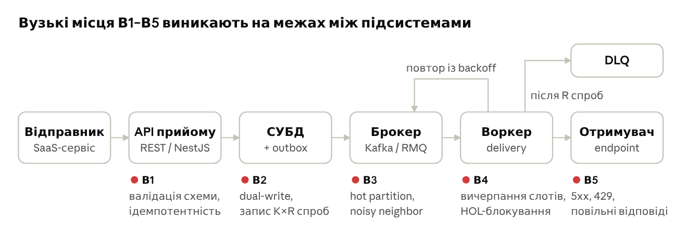

# РОЗДІЛ 1. АНАЛІЗ ПРЕДМЕТНОЇ ОБЛАСТІ ТА ПОСТАНОВКА ЗАДАЧІ ДОСЛІДЖЕННЯ

## 1.1. Актуальність вибраної теми дослідження

Вебхуки є основним механізмом асинхронної інтеграції SaaS-систем: платіжних сервісів, CRM, CI/CD-платформ і маркетплейсів. Гарантована доставка події у розподіленому середовищі вимагає розв'язання низки задач. Недоступність отримувача, тайм-аути та помилкові відповіді спричиняють втрату подій. Повторні спроби породжують дублікати, а паралельна обробка порушує порядок доставки. Блокування черги необробленим головним повідомленням (head-of-line blocking) збільшує латентність. Ефект «шумного сусіда» погіршує обслуговування інших ізольованих логічних середовищ клієнтів, коли одне ізольоване логічне середовище клієнта створює високе навантаження. Вектор атаки становлять також підробка запитів і SSRF через URL endpoint-а. Ці задачі потребують поєднання механізмів забезпечення відмовостійкості (Transactional Outbox, Idempotent Consumer, Circuit Breaker, Bulkhead, Dead Letter Queue), алгоритмів справедливого розподілу пропускної здатності та криптографічного захисту каналу доставки.

Надійність платформи доставки залежить і від середовища виконання: кількості ядер CPU, обсягу оперативної пам'яті, типу СУБД і брокера повідомлень. Відкриті кількісні дані про вплив цих факторів на пропускну здатність, латентність і збереженість подій практично відсутні. Тому конфігурацію інфраструктури обирають емпірично, що веде або до надлишкових витрат на ресурси, або до втрати подій під піковим навантаженням. Отже, актуальними є розробка платформи з відокремленою від інфраструктури доменною логікою та експериментальне визначення точок насичення й мінімальних конфігурацій, які забезпечують задані нефункціональні вимоги.

### Об'єкт дослідження

Об'єктом дослідження є процес гарантованої асинхронної доставки подій (вебхуків) між програмними системами в розподіленому середовищі з ізольованими логічними середовищами клієнтів за змінного навантаження та відмов компонентів інфраструктури.

### Предмет дослідження

Предметом дослідження є методи та засоби, що забезпечують стійкість процесу гарантованої доставки подій до навантаження та відмов, а саме:

- архітектурні патерни Transactional Outbox, Idempotent Consumer, Circuit Breaker, Bulkhead і Dead Letter Queue;
- алгоритми експоненційного backoff із jitter, Token Bucket і Deficit Round Robin;
- їх програмна реалізація в модульному моноліті з архітектурою Ports & Adapters і CQRS на базі TypeScript, NestJS, Apache Kafka, RabbitMQ, PostgreSQL, MySQL, MongoDB, Redis і Kubernetes;
- експериментальне оцінювання впливу конфігурацій обчислювальних ресурсів і сховищ даних на пропускну здатність, латентність і збереженість подій.

### Мета роботи

Метою роботи є розробка платформи гарантованої доставки вебхуків з ізольованими логічними середовищами клієнтів на основі модульного моноліту з архітектурою Ports & Adapters і патернів Transactional Outbox, Circuit Breaker та Bulkhead з експериментальним оцінюванням впливу конфігурацій обчислювальних ресурсів і сховищ даних на її стійкість до навантаження для забезпечення асинхронної доставки подій між програмними системами без втрат за гарантії at-least-once та обґрунтованого вибору мінімальної конфігурації інфраструктури.

### Завдання проєкту

1. Проаналізувати предметну область і наявні аналоги (Svix, Hookdeck, Convoy) за характеристиками моделі якості ДСТУ ISO/IEC 25010:2016 та сформулювати функціональні й нефункціональні вимоги до платформи.
2. Обґрунтувати вибір архітектурного стилю (модульний моноліт порівняно з мікросервісною архітектурою) і технологічного стеку та зафіксувати рішення в Architecture Decision Records.
3. Спроєктувати архітектуру платформи за моделлю C4 і нотацією UML. Виділити bounded contexts (Ingestion, Routing, Delivery, Tenancy, Observability), визначити порти й адаптери сховищ і брокерів, а також fitness functions для автоматизованого контролю меж модулів.
4. Розробити алгоритми критичних вузлів: ретрансляцію подій із Transactional Outbox, планування повторних спроб поза чергою брокера з експоненційним backoff і jitter, Circuit Breaker і Bulkhead на рівні endpoint-а, атомарне обмеження частоти запитів (Token Bucket) і справедливий розподіл пропускної здатності між ізольованими логічними середовищами клієнтів (Deficit Round Robin), підписування запитів HMAC-SHA256 і захист від SSRF.
5. Спроєктувати інтерфейс адміністративної панелі, контракт API, а також схему розгортання в Kubernetes з описом інфраструктури як коду (Terraform, Helm, Argo CD) та автомасштабуванням воркерів за consumer lag (KEDA).
6. Провести інструментальний аудит якості та безпеки програмного коду. Для цього застосувати модульне, інтеграційне (Testcontainers) і property-based (fast-check) тестування, статичний аналіз (SonarQube, Semgrep), сканування залежностей і образів (Trivy, gitleaks), моделювання загроз за STRIDE та оцінювання відповідності вимогам OWASP ASVS Level 2.
7. Провести експериментальне дослідження стійкості платформи до навантаження (k6, Toxiproxy) за факторами кількості ядер CPU, обсягу RAM, типу СУБД, брокера повідомлень і кількості реплік воркерів та визначити точки насичення й мінімальні конфігурації, що відповідають нефункціональним вимогам. Апробувати результати в науковій публікації або доповіді на конференції.

Для розв'язання сформульованих завдань у підрозділі 1.2 розглянуто сучасні підходи до інтеграції програмних систем, гарантованої доставки повідомлень і ізоляції навантаження, на які спирається подальший аналіз.

## 1.2. Огляд сучасних підходів до вирішення відповідних завдань в межах обраного дослідження

### 1.2.1. Моделі інтеграції програмних систем

Обмін подіями між незалежними програмними системами реалізується за
трьома моделями: опитування за ініціативою споживача (pull), виклик за
ініціативою постачальника (push) та потокова підписка [1].

За моделі опитування (polling) споживач періодично надсилає запити до
API постачальника. Затримка виявлення події обмежена знизу інтервалом
опитування, а частка запитів без нових даних зростає зі зменшенням
частоти подій. Long polling утримує запит відкритим до появи події або
спливання тайм-ауту: затримка скорочується, проте сервер утримує
відкриті з'єднання, а проміжні проксі можуть завчасно розривати їх
[2].

Вебхук (webhook) — модель, за якої постачальник у момент виникнення
події надсилає HTTP-запит (як правило, POST) на зареєстровану споживачем
URL-адресу. Відповідальність за доставку переходить до постачальника:
він зберігає подію, повторює спроби за відмов кінцевої точки та обмежує
інтенсивність запитів, оскільки доступність і пропускна здатність
споживача перебувають поза його контролем.

Потокові підписки ґрунтуються на довготривалому з'єднанні. WebSocket
забезпечує двоспрямований обмін кадрами поверх одного TCP-з'єднання
[3]. Server-Sent Events (SSE) передає односпрямований текстовий потік
від сервера до клієнта з відновленням за ідентифікатором останньої
отриманої події [4]. WebSub визначає публікацію-підписку через
проміжний вузол (hub), який доставляє вміст підписникам HTTP-запитами,
тобто за моделлю вебхуків [5].

Таблиця 1.1 — Порівняння моделей інтеграції

| Модель          | Ініціатор передачі             | Затримка доставки     | Вимога до споживача            | Відповідальність за повтори         |
|---------------|------------------------------|---------------------|------------------------------|-----------------------------------|
| Polling         | Споживач                       | ≥ інтервал опитування | Клієнт HTTP                    | Споживач                            |
| Long polling    | Споживач                       | Мала                  | Утримання відкритого запиту    | Споживач                            |
| Webhook         | Постачальник                   | Мала                  | Публічно досяжна кінцева точка | Постачальник                        |
| WebSocket / SSE | Постачальник у межах з'єднання | Мала                  | Постійне з'єднання             | Сторони протоколу прикладного рівня |
| WebSub          | Hub                            | Мала                  | Публічно досяжна кінцева точка | Hub                                 |

Критеріями вибору моделі є напрям ініціативи, допустима затримка,
здатність споживача утримувати постійне з'єднання, наявність у нього
публічно досяжної кінцевої точки, вимоги до збереження подій під час
тимчасової недоступності сторони та кількість одержувачів.

У межах кваліфікаційної роботи обрано модель вебхуків, оскільки
предметом дослідження є доставка подій зовнішнім серверним споживачам,
від яких не вимагається утримання постійного з'єднання.

### 1.2.2. Семантики доставки повідомлень у розподілених системах

Семантика доставки визначає, скільки разів повідомлення може справити
ефект на стороні одержувача за наявності відмов мережі та процесів
[6]:

- at-most-once — відправник не повторює спробу; повідомлення може бути
  втрачене, але не дублюється;

- at-least-once — відправник повторює спробу до отримання підтвердження;
  за умови стійкого зберігання втрата виключається, проте можливі
  дублікати;

- exactly-once — кожне повідомлення справляє ефект рівно один раз.

Для HTTP-доставки семантика exactly-once на транспортному рівні
недосяжна. Після надсилання запиту та спливання тайм-ауту відправник не
розрізняє три стани: запит не надійшов; запит оброблено, але відповідь
втрачено; обробка ще триває. Ця невизначеність є окремим випадком задачі
двох генералів (two generals problem): жодна скінченна кількість обмінів
ненадійним каналом не забезпечує обом сторонам спільного знання про
результат [6]. Повторна спроба в такому стані може створити дублікат,
відмова від неї — призвести до втрати. Транзакційні механізми брокерів
повідомлень діють лише в межах власного протоколу й не поширюються на
зовнішню кінцеву точку.

Ефект «рівно один раз» досягається на прикладному рівні поєднанням
at-least-once доставки з ідемпотентним споживачем (Idempotent Receiver)
[1, 7]. Кожна подія отримує стабільний унікальний ідентифікатор, що
передається в заголовку запиту й не змінюється між спробами; одержувач
фіксує ідентифікатори оброблених подій і відкидає повтори.

У межах кваліфікаційної роботи обрано семантику at-least-once з
передаванням стабільного ідентифікатора події, оскільки лише вона
виключає втрату подій без припущень щодо поведінки зовнішнього
одержувача.

### 1.2.3. Підходи до атомарності запису та публікації подій

Подія виникає в межах бізнес-транзакції, а її публікація потребує запису
в іншу систему — брокер або чергу повідомлень. Подвійний запис (dual
write), тобто послідовний запис у базу даних і брокер без спільної
транзакції, у разі відмови між двома операціями призводить до
неузгодженості: стан зафіксовано без публікації події або подію
опубліковано без фіксації стану [6, 8]. Розподілені транзакції (2PC)
усувають цю проблему ціною зниження доступності та зв'язування учасників
і часто не підтримуються брокерами [8].

Патерн Transactional Outbox передбачає запис події до таблиці (колекції)
outbox тієї самої бази даних у межах локальної транзакції, що змінює
стан; окремий процес-ретранслятор (message relay) передає записи до
брокера [8]. Вибирання записів здійснюється двома способами:

- polling publisher — періодичний запит до outbox з позначенням або
  видаленням опублікованих записів; реалізація переноситься між СУБД без
  змін, проте додає навантаження запитами та затримку, обмежену знизу
  інтервалом опитування;

- CDC (Change Data Capture, transaction log tailing) — читання журналу
  змін СУБД (WAL у PostgreSQL, binlog у MySQL, change streams у
  MongoDB); опитувальні запити відсутні, затримка менша, проте
  реалізація залежить від механізмів конкретної СУБД і потребує
  додаткової інфраструктури.

Обидва способи забезпечують публікацію за семантикою at-least-once,
отже, подальші етапи обробки мають бути ідемпотентними.

Event sourcing зберігає стан агрегату як упорядковану послідовність
подій: запис події і є зміною стану, тому проблема подвійного запису не
виникає [8]. Компромісом є зміна моделі зберігання, потреба в окремих
проєкціях для запитів (узгоджується з CQRS) та складність еволюції схеми
подій.

У межах кваліфікаційної роботи обрано Transactional Outbox з polling
publisher, оскільки цей варіант однаково реалізується для PostgreSQL,
MySQL і MongoDB, що є умовою порівняння сховищ даних як фактора
експерименту.

### 1.2.4. Патерни відмовостійкості

Платформа доставки вебхуків взаємодіє з кінцевими точками, доступність
яких не контролюється. Точки інтеграції з зовнішніми системами є
основним джерелом каскадних відмов, а їхній вплив обмежується набором
стабілізувальних патернів [9].

Повторні спроби з експоненційною затримкою (exponential backoff)
збільшують інтервал між спробами за правилом

$$t_n = \min\left(t_{max},\ t_0 \cdot 2^{n}\right)$$

де t_0 — базовий інтервал, n — номер спроби, t_max — верхня межа
інтервалу. За одночасної відмови багатьох доставок детермінований
розклад породжує синхронні хвилі повторів; додавання випадкової
складової (jitter), наприклад вибір затримки з рівномірного розподілу на
[0, t_n], розосереджує повтори в часі [10]. Кількість спроб або
сумарне вікно повторів обмежується.

Dead Letter Queue (у термінології [1] — Dead Letter Channel) — окреме
сховище повідомлень, для яких вичерпано ліміт спроб або отримано
відповідь, що не підлягає повтору (наприклад, коди 4xx, крім 408 і 429).
DLQ зберігає подію для аналізу та ручного повторного відтворення
(replay) без блокування основного потоку.

Тайм-аути обмежують час встановлення з'єднання та очікування відповіді;
за їх відсутності повільна кінцева точка утримує робочі потоки й
з'єднання необмежено довго [9].

Circuit Breaker реалізує автомат зі станами closed, open і half-open:
після перевищення порогу відмов виклики до кінцевої точки припиняються
на заданий інтервал, після чого виконується пробний виклик [9]. Для
доставки вебхуків стан вимикача ведеться окремо для кожної кінцевої
точки.

Bulkhead розподіляє ресурси (пули з'єднань, черги, екземпляри
worker-процесів) на ізольовані розділи, тому вичерпання одного розділу
не поширюється на інші [9].

У межах кваліфікаційної роботи обрано поєднання всіх п'яти патернів,
оскільки вони діють на різних рівнях — окремого запиту, кінцевої точки,
розділу ресурсів і події з вичерпаним лімітом спроб — та не заміщують
один одного.

### 1.2.5. Підходи до ізоляції навантаження в мультиклієнтських системах

У мультиклієнтській системі ресурси доставки спільні для кількох
ізольованих логічних середовищ клієнта (tenant). За відсутності ізоляції
сплеск подій одного клієнта або повільна кінцева точка займає спільні
worker-процеси, і повідомлення інших логічних середовищ клієнтів очікують у спільній FIFO-черзі (ефект noisy neighbor).

Обмеження частоти (rate limiting) регулює інтенсивність запитів [11]:

- Token Bucket — відро ємністю b поповнюється токенами зі швидкістю r, а
  запит пропускається за наявності токена; допускаються сплески до b
  запитів за середньої інтенсивності r;

- Leaky Bucket — запити надходять до черги обмеженого розміру й
  вибираються зі сталою швидкістю; вихідний потік згладжується, сплески
  не пропускаються;

- Sliding Window — кількість запитів підраховується в ковзному часовому
  вікні (журналом часових міток або зваженою комбінацією лічильників
  поточного та попереднього фіксованих вікон); усувається подвоєння
  ліміту на межі фіксованих вікон.

Обмеження частоти не визначає порядку обслуговування між клієнтами, тому
доповнюється справедливим плануванням. Fair Queuing виділяє кожному
потоку окрему чергу й наближено відтворює побітовий round robin; для
цього обчислюється час завершення кожного пакета, що потребує
впорядкування зі складністю O(log n) [12]. Deficit Round Robin (DRR)
призначає кожній черзі квант Q і лічильник дефіциту: за один обхід черга
обслуговує повідомлення, доки їхня сумарна вартість не перевищить
накопиченого дефіциту [13]. DRR забезпечує справедливість, близьку до
Fair Queuing, зі складністю O(1) на повідомлення; вартістю повідомлення
може слугувати розмір корисного навантаження або очікуваний час
доставки.

У межах кваліфікаційної роботи обрано Token Bucket для обмеження інтенсивності прийому та доставки в межах кожного ізольованого логічного середовища клієнта та DRR для планування між їхніми чергами, оскільки це поєднання обмежує частку спільних ресурсів, яку може зайняти одне середовище, за сталої складності планування.

### 1.2.6. Методи оцінювання стійкості до навантаження

Стійкість до навантаження оцінюється експериментально: за контрольованих
умов вимірюються пропускна здатність, розподіл затримок (перцентилі p50,
p95, p99), частка помилок і використання обчислювальних ресурсів [14].
Навантажувальне тестування застосовує такі профілі:

- сталий — фіксована інтенсивність надходження запитів для визначення
  параметрів сталого режиму;

- ступінчастий — покрокове зростання інтенсивності для визначення точки
  насичення;

- пульсуючий (spike) — короткочасні сплески для оцінювання накопичення
  черг і часу відновлення;

- тривалий (soak) — помірна інтенсивність упродовж кількох годин для
  виявлення витоків ресурсів і поступової деградації.

Генерування навантаження за відкритою моделлю (open model), у якій
інтенсивність надходження задається незалежно від часу відповіді
системи, виключає заниження затримок, характерне для закритої моделі з
фіксованою кількістю віртуальних користувачів.

Хаос-інженерія розглядає систему як об'єкт експерименту: формулюється
гіпотеза про сталий стан, вимірюваний метриками, після чого вносяться
відмови, що відтворюють реальні події (затримки, розриви з'єднань,
недоступність залежностей), і перевіряється збереження сталого стану
[15].

Закон Літтла пов'язує середню кількість заявок у стаціонарній системі L,
інтенсивність їх надходження λ та середній час перебування W незалежно
від вигляду розподілів [16]:

$$L = \lambda W$$

Для платформи доставки L інтерпретується як кількість одночасних
HTTP-запитів: інтенсивність 1000 подій/с за середнього часу відповіді
кінцевої точки 200 мс потребує 200 паралельних доставок. Закон
застосовується для аналітичного прогнозу необхідної паралельності
worker-процесів і перевірки узгодженості виміряних показників.

У межах кваліфікаційної роботи обрано комбінований методологічний
підхід: генерування навантаження засобом k6 за відкритою моделлю з
чотирма профілями, внесення мережевих відмов кінцевих точок і сховищ
даних засобом Toxiproxy та закон Літтла як модель ємності. Такий підхід
забезпечує відтворюване порівняння конфігурацій обчислювальних ресурсів,
СУБД і брокерів повідомлень за однакових умов навантаження й відмов.

## 1.3. Аналіз та порівняння існуючих рішень на ринку готових програмних продуктів

Усі три аналоги реалізують єдину базову схему обробки: «прийняти подію → персистувати → поставити в чергу → доставити HTTP POST із повторними спробами». Відмінності між ними стосуються мови реалізації, топології процесів і ролі Redis як транспорту черги. Зв'язка «реляційна СУБД + Redis-черга» є спільним архітектурним обмеженням усіх трьох систем і водночас ключовим предметом дослідження в межах кваліфікаційної роботи.

Аналіз виконано за чотирма критеріями: (1) архітектурний патерн і його вплив на масштабованість; (2) протоколи зовнішньої та внутрішньої взаємодії; (3) стек зберігання даних і механізми консистентності; (4) відомі технічні обмеження. Як джерела використано відкриті репозиторії (Svix, Convoy, Hookdeck Outpost), офіційну документацію, офіційні статус-сторінки та інженерні блоги розробників. Для Hookdeck Event Gateway, вихідний код якого закритий, висновки ґрунтуються виключно на публічних технічних публікаціях компанії та позначені відповідним чином.

### 1.3.1. Svix

Svix — сервіс вихідних вебхуків (webhooks-as-a-service) з відкритим ядром svix-server, що поширюється за ліцензією MIT. Сервер реалізовано мовою Rust. Хмарна версія, за заявою розробників, побудована на тому самому коді, проте містить додаткову інфраструктуру та оптимізації, відсутні у відкритому репозиторії [17].

#### Архітектурний патерн

Сервер svix-server є модульним монолітом, що розгортається як один бінарний файл із перемикачами ролей процесу. Конфігурація містить прапорці api_enabled, worker_enabled і background_migrations_enabled, тому один і той самий артефакт запускається як API-вузол, як delivery-воркер або в обох ролях одночасно [18]. Залежності сервера, задекларовані в Cargo.toml [19], визначають такі шари: HTTP-шар на фреймворку axum із генерацією OpenAPI засобами aide, шар даних на sea-orm/sqlx для PostgreSQL та абстракцію черги omniqueue.

Вплив на масштабованість:

- API-вузли та воркери масштабуються горизонтально й незалежно, оскільки обидві ролі є stateless, а стан винесено в PostgreSQL і Redis.
- Паралелізм одного воркера обмежено параметром worker_max_tasks (за замовчуванням 500 конкурентних задач) і тайм-аутом HTTP-запиту worker_request_timeout (30 с). Якщо кожен отримувач відповідає лише після спливу тайм-ауту, один воркер завершує не більше ніж 500 / 30 с ≈ 17 доставок/с. Наведене значення є аналітичною оцінкою найгіршого випадку, а не опублікованою метрикою: оцінка не враховує повторні спроби, throttling, накладні витрати на БД і чергу та потребує експериментальної перевірки.
- Межею масштабування є спільні сховища: усі вузли записують дані в один кластер PostgreSQL і читають одну Redis-чергу.

#### Протоколи передачі даних

- Зовнішній API: REST поверх HTTP/JSON зі специфікацією OpenAPI, на основі якої генеруються SDK для 9 мов програмування. Автентифікація здійснюється за допомогою JWT у заголовку Authorization: Bearer. gRPC, GraphQL і WebSocket у публічному API відсутні.
- Доставка: HTTP(S) POST на кінцеву точку отримувача. Підпис формується за алгоритмом HMAC-SHA256 (симетричний, за замовчуванням) або Ed25519 (асиметричний); формат відповідає специфікації Standard Webhooks. За даними README, симетричний підпис приблизно в 50 разів швидший під час підписання та в 160 разів — під час перевірки.
- Внутрішня взаємодія: обмін між сервером і сховищами відбувається за протоколами PostgreSQL wire і RESP (Redis). Телеметрія експортується за протоколом OTLP на колектор OpenTelemetry (типова адреса :4317, gRPC).
- Захист від SSRF: надсилання запитів на приватні IP-адреси заблоковано за замовчуванням і дозволяється лише через параметр whitelist_subnets.

#### Стек даних і консистентність

Склад сховищ Svix та їхні ролі наведено в таблиці 1.2.

Таблиця 1.2 — Стек зберігання даних Svix

| Сховище | Роль | Обмеження |
|---------------------|----------------------------------------------------------------------|----------------------------------------------------------------------|
| PostgreSQL | Єдине джерело істини: застосунки, кінцеві точки, повідомлення, спроби доставки | Інші СУБД не підтримуються; пул за замовчуванням — 100 з'єднань, рекомендовано PgBouncer |
| Redis / Redis Cluster | Черга задач доставки та розподілений кеш | Обов'язкові persistence і maxmemory-policy = noeviction або volatile-\* |
| In-memory | Альтернативна черга й кеш для одного екземпляра | Порушує коректність ідемпотентності за наявності кількох API-вузлів |

Документована конфігурація допускає типи черги memory, redis і rediscluster. Водночас Cargo.toml підключає omniqueue з функціями rabbitmq-with-message-ids і redis_sentinel, тобто в коді присутні адаптери RabbitMQ і Redis Sentinel, не описані в config.default.toml.

Механізми консистентності:

- Повторні спроби: фіксований розклад retry_schedule = [21, 316, 1816, 7216, 18016, 36016, 36016] с, що відповідає 8 спробам упродовж приблизно 27 год. Кінцева точка автоматично вимикається після 120 год безперервних помилок.
- Ідемпотентність API: ключ ідемпотентності зберігається в кеші. Документація прямо застерігає, що за використання in-memory кешу та кількох API-серверів ідемпотентність працює некоректно, тобто гарантія залежить від Redis.
- DLQ: Redis не має вбудованої черги недоставлених повідомлень, тому Svix реалізує власну DLQ для задач, обробка яких завершилася збоєм із внутрішніх причин. Її глибину відображає метрика svix.queue.depth_dlq, а повторна обробка запускається запитом POST /api/v1/admin/redrive-dlq/.
- Порядок доставки: для звичайних кінцевих точок порядок забезпечується за принципом best-effort. Строгий FIFO доступний як окремий тип кінцевої точки, що очікує підтвердження кожного надсилання і для компенсації зниження пропускної здатності доставляє повідомлення пакетами [21].
- Семантика доставки: at-least-once; дедуплікацію покладено на отримувача, який виконує її за заголовком ідентифікатора повідомлення.

#### Технічні обмеження

- Подвійний запис PostgreSQL → Redis. Подія фіксується в PostgreSQL, а задача доставки — у Redis. Довговічність черги залежить від налаштування AOF/RDB у Redis: без persistence перезапуск Redis знищує задачі, що прямо визнано в документації.
- Redis як буфер повторних спроб. У разі масової недоступності отримувачів задачі накопичуються в оперативній пам'яті впродовж до 27 год (тривалість розкладу повторних спроб). Обсяг backlog обмежено обсягом RAM, а політика noeviction у разі переповнення пам'яті переводить Redis у режим відмови в записі.
- Write amplification у PostgreSQL. Кожна спроба доставки зберігається окремим записом; за розкладом повторних спроб одне повідомлення за N кінцевих точок породжує до 8·N записів спроб (аналітична оцінка на основі retry_schedule). Хмарна версія обслуговує запити читання з окремої «message analytics db»: інцидент 17.07.2025 супроводжувався зростанням латентності API читання саме з цієї БД за незмінної доставки [24], а 12.08.2026 нові повідомлення із запізненням з'являлися в list-message API за нормальної доставки [28].
- Розподілений rate limiting. Документація визнає, що фактична швидкість може перевищувати встановлений ліміт, наприклад 1050 повідомлень/с за ліміту 1000 повідомлень/с [20]. Постмортем 16.12.2024 описує стан гонитви в новому механізмі throttling, який проявлявся лише за тривалого backpressure на межі ліміту та зростання латентності AWS SQS. Оскільки throttled-повідомлення виключені з метрик затримки доставки, збій не спричинив спрацювання алертів [22]. Аналогічні затримки, зумовлені станом гонитви, повторювалися 17.07.2025 і 12.09.2025 [23, 25].
- Великі payload. 04.12.2025 повідомлення розміром понад 300 КБ доставлялися із затримкою в регіоні US [26], що може свідчити про нелінійне зростання вартості обробки великих тіл повідомлень.
- Швидкість еластичного масштабування. 03.06.2026 сплеск трафіку в 161 раз відносно попередньої хвилини спричинив підвищення латентності та частоти помилок у регіоні EU, оскільки система не масштабувалася достатньо швидко; ураженими виявилися клієнти, маршрутизовані на ті самі вузли [27].
- Розбіжність OSS- і хмарної версії. README прямо зазначає, що частина оптимізацій хмарного диспетчера відсутня у відкритому коді. Постмортем 2024 р. показує, що хмарний контур throttling використовує AWS SQS, тоді як документована конфігурація OSS обмежена Redis і in-memory. Тому результати навантажувального тестування self-hosted-версії не є репрезентативними щодо поведінки хмарного продукту.

### 1.3.2. Hookdeck

Hookdeck складається з двох інженерно відмінних систем. Event Gateway — керований SaaS для вхідних вебхуків із закритим кодом. Outpost — відкрита (Apache-2.0) платформа вихідних вебхуків, реалізована мовою Go; хмарна версія запускає її без окремого форку [32]. Для порівняння з проєктованою системою найбільш релевантним є Outpost; Event Gateway аналізується на основі публічних інженерних публікацій компанії.

#### Архітектурний патерн

Event Gateway має розподілену сервісну (мікросервісну) архітектуру з фізично ізольованим контуром прийому. Сервіс http-ingestion має окремий репозиторій і конвеєр CI/CD, не поділяє з рештою системи код, VM, кластер чи БД і залежить лише від Cloudflare DNS та Cloudflare Workers [29]. Ядро обробки функціонує в Kubernetes із розгортанням у кількох зонах доступності. Таке рішення є реалізацією патерну Bulkhead на рівні інфраструктури: збій доставки не зупиняє прийом, а прийняті події доставляються пізніше.

Outpost є сервісно-орієнтованим монолітом із трьох сервісів, які запускаються в одному процесі або як окремі об'єкти Deployment для незалежного масштабування [33]:

- API Service — прийом подій і конфігурація ізольованих логічних середовищ клієнтів (tenant) та destination;
- Delivery Service — доставка через адаптери для кожного типу призначення;
- Log Service — збереження подій, статусів і відповідей.

Вплив на масштабованість: Delivery-воркери масштабуються горизонтально як конкурентні споживачі зовнішнього брокера, а пропускна здатність визначається брокером, а не процесом Outpost. Водночас Outpost за проєктним рішенням не реалізує розподіл швидкості доставки на рівні ізольованого логічного середовища клієнта, що обґрунтовується в документації складністю та вартістю такої архітектури [31].

#### Протоколи передачі даних

- Зовнішній API: REST поверх HTTP/JSON для обох продуктів. Публікація в Outpost здійснюється запитом POST /publish, на який повертається відповідь HTTP 202 з ідентифікатором події. Доступ до порталу ізольованого логічного середовища клієнта надається за короткоживучим JWT.
- Інструменти розробника: Hookdeck CLI отримує події для локальної переадресації через WebSocket (параметр --ws-base) [34].
- Доставка (Outpost): окрім HTTP POST із підписом за Standard Webhooks, підтримуються нативні протоколи призначень — AMQP (RabbitMQ), протокол Kafka, API AWS (SQS, EventBridge, Kinesis, S3), GCP Pub/Sub, Azure Service Bus, Cloudflare Queues. Це є реалізацією специфікації Event Destinations, тобто доставка не обмежена протоколом HTTP.
- Внутрішній транспорт Outpost: сервіси API та Delivery обмінюються даними через зовнішній брокер — SQS, RabbitMQ, GCP Pub/Sub, Azure Service Bus або NATS JetStream.
- Внутрішній транспорт Event Gateway: CDC-потік PostgreSQL → Kafka (Debezium/Kafka Connect) → ClickHouse.

#### Стек даних і консистентність

Склад сховищ обох продуктів Hookdeck наведено в таблиці 1.3.

Таблиця 1.3 — Стек зберігання даних Hookdeck

| Сховище | Продукт | Роль |
|------------------------------------------------------|----------------------|----------------------------------------------------------------------|
| PostgreSQL | Event Gateway, Outpost | Транзакційні дані подій і спроб (EG); журнал подій (Outpost, варіант 1) |
| Redis 6.0+ | Event Gateway, Outpost | Обов'язковий для API і Delivery Outpost; рекомендовано RDB або AOF persistence |
| Брокер (SQS / RabbitMQ / Pub/Sub / Service Bus / NATS) | Outpost | Черга доставки між сервісами |
| Kafka + Debezium | Event Gateway | CDC-конвеєр із PostgreSQL в аналітичне сховище |
| ClickHouse | Event Gateway, Outpost | Аналітика користувацького dashboard (EG); журнал подій (Outpost, варіант 2) |

Механізми консистентності:

- Семантика доставки: at-least-once для Outpost; повторні спроби налаштовуються параметрами MAX_RETRY_LIMIT, RETRY_INTERVAL_SECONDS, RETRY_SCHEDULE.
- Розрив між прийомом і читанням: відповідь 202 Accepted підтверджує лише надходження події в конвеєр. Документація прямо визначає, що API подій і спроб одразу після публікації може повертати порожній результат, що відповідає eventual consistency між шляхом запису і журналом.
- Аналітика Event Gateway: зміни станів подій (QUEUED → DELIVERED) потрапляють у ClickHouse через CDC як послідовність рядків. Дедуплікацію виконує рушій VersionedCollapsingMergeTree асинхронно й недетерміновано, тому запити мають враховувати наявність дублікатів (агрегація через sum(sign)) [30].

#### Технічні обмеження

- Межа масштабування PostgreSQL на шляху читання. Початково весь стек зберігання будувався на PostgreSQL. Після зростання таблиць понад 1 млрд рядків запити гістограм dashboard виконувалися понад 30 с, а індексування за більш ніж 10 вимірами стало непрактичним. Перехід на ClickHouse скоротив обсяг даних з 400 ГБ до 45 ГБ, а середній час запиту — до 2 с.
- Складність polyglot persistence. Розв'язання проблеми шляху читання додало до PostgreSQL і Redis компоненти Kafka, Kafka Connect, Debezium і ClickHouse. Інженерний блог компанії визнає недоліки Kafka table engine: появу дублікатів унаслідок семантики at-least-once, споживання ресурсів ClickHouse і складність налагодження помилок.
- Залежність контуру прийому від edge-провайдера. Доступність прийому прив'язана до Cloudflare Workers, тому ліміти та інциденти цієї платформи безпосередньо впливають на продукт (vendor lock-in на найбільш критичній ланці).
- Пріоритет доступності над затримкою. Компанія публічно зазначала, що оптимізувала передусім доступність, а передбачувана латентність під навантаженням залишалася ціллю на майбутнє.
- Відсутність fairness між ізольованими логічними середовищами клієнтів в Outpost. Через відмову від per-tenant rate limiting одне «шумне» ізольоване логічне середовище клієнта з повільними endpoint може займати спільні Delivery-воркери та збільшувати затримку для інших ізольованих логічних середовищ клієнтів.
- Три обов'язкові stateful-залежності Outpost. Мінімальна production-конфігурація вимагає Redis із persistence, зовнішнього брокера та PostgreSQL або ClickHouse; відмова будь-якого з них зупиняє відповідний сервіс.
- Закритий код Event Gateway. Архітектуру ядра неможливо перевірити або відтворити для незалежного навантажувального тестування; доступні лише заяви розробника.

### 1.3.3. Convoy

Convoy (Frain Technologies) — шлюз вебхуків для вхідного і вихідного трафіку, реалізований мовою Go та поширюваний за ліцензією Elastic License 2.0 [35]. Серед трьох аналогів він найближчий до проєктованої системи за набором патернів надійності: Circuit Breaker, rate limiting на рівні endpoint, ключі ідемпотентності, ingest із брокерів повідомлень.

#### Архітектурний патерн

Convoy є монолітом із поділом на control plane і data plane: один бінарний файл і образ із підкомандами [44]:

- server (convoy server, control plane) — HTTP API, вебінтерфейс адміністрування, керування проєктами й endpoint;
- agent (convoy agent, data plane) — обробники задач черги asynq: створення подій, fan-out, доставка, повторні спроби; у цьому ж процесі виконується споживання повідомлень із брокерів (internal/dataplane/ingest.go);
- migrate — разовий процес міграції схеми.

Офіційний Helm-чарт [43] додатково містить окремі образи ingest і stream, тобто топологія розгортання допускає винесення споживання повідомлень із брокерів в окремий об'єкт Deployment.

Внутрішньо реалізовано pipeline на основі задач asynq: подія → fan-out за підписками → задача доставки для кожного endpoint. Вплив на масштабованість: server і agent масштабуються горизонтально й незалежно, а координація між екземплярами agent здійснюється через Redis (розподілені блокування redsync). Межею масштабування, як і в Svix, є спільний Redis і єдиний кластер PostgreSQL.

#### Протоколи передачі даних

- Зовнішній API: REST поверх HTTP/JSON (маршрутизатор go-chi), специфікація OpenAPI, на основі якої генеруються SDK для 6 мов програмування. Версіонування API реалізовано через request migrations — трансформацію запитів і відповідей між версіями.
- Ingest: три класи джерел — автентифікований REST API, неавтентифікований ingest-endpoint для вхідних вебхуків і брокери повідомлень Apache Kafka, Amazon SQS, Google Pub/Sub, RabbitMQ (бета) [41]. Відповідно, використовуються протокол Kafka, AMQP 0-9-1, HTTPS API AWS і gRPC-клієнт Pub/Sub.
- Доставка: HTTP(S) POST з HMAC-підписом (схеми «simple» та «advanced»); для автентифікації на стороні отримувача підтримуються Bearer, OAuth2 і mTLS, а також статичні вихідні IP-адреси.
- Внутрішня взаємодія: RESP (Redis), PostgreSQL wire protocol, OTLP/gRPC для трасування, Prometheus для метрик.
- Трансформації: користувацькі JavaScript-функції виконуються вбудованим інтерпретатором goja в процесі воркера.

#### Стек даних і консистентність

Склад сховищ Convoy наведено в таблиці 1.4.

Таблиця 1.4 — Стек зберігання даних Convoy

| Сховище | Роль | Примітка |
|-----------------------|----------------------------------------------------------------------|----------------------------------------------------------------------|
| PostgreSQL | Джерело істини: проєкти, endpoint, події, доставки (event_deliveries) | Драйвер pgx; пул за замовчуванням — 100 з'єднань (DefaultMaxOpenConnections, config/config.go) [39]; керування партиціями (internal/pkg/partitions, gopartman) |
| Redis | Черга asynq, rate limit (redis_rate), кеш, розподілені блокування (redsync) | redis:7-alpine у docker-compose.dep.yml [40]; приклад конфігурації Sentinel (convoy.sentinel.json.example), адреси кластера в Helm-чарті |
| PostgreSQL (черга) | Альтернативна реалізація черги доставки | Експериментальний, доступний лише за ліцензією [35] |
| S3 / MinIO / Azure Blob | Резервне копіювання й архівація даних (cmd/backup) | Залежності minio-go, azblob у go.mod [36] |

Механізми консистентності:

- Ідемпотентність: ключ idempotency_key передається в запиті на створення події, а для джерел задається набір полів, з яких він обчислюється. Події з повторним ключем дедуплікуються.
- Повторні спроби: підтримуються дві стратегії — з константним інтервалом і з експоненційним backoff та jitter, а також пакетні ручні повторні спроби.
- Circuit Breaker: у разі послідовних помилок endpoint Circuit Breaker переходить у розімкнений стан, а відновлення трафіку відбувається після пробних запитів; після тривалих збоїв endpoint вимикається з надсиланням сповіщення.
- Брокер як джерело: ingest із Kafka або SQS переносить гарантію «прийнято» на брокер, оскільки зафіксоване повідомлення буде прочитане повторно до моменту успішної обробки [42]. Для трасування зберігається brokerMessageId.

#### Технічні обмеження

- Історичний технічний борг рівня зберігання. Початково основною СУБД була MongoDB. Розробники визнали цей вибір невдалим через проблеми з міграціями схеми, складність оптимізації запитів і потребу в replica set навіть для одного вузла, оскільки MongoDB не підтримує транзакції на окремому екземплярі (standalone). У версії v0.9 (2023) основною СУБД став PostgreSQL [42].
- Redis на критичному шляху. Черга, rate limiting, блокування й кеш зосереджені в одному сховищі Redis. Відмова або перевантаження Redis одночасно зупиняє доставку, лімітування і координацію воркерів, а backlog за недоступності endpoint обмежений обсягом RAM.
- Підтвердження прийому без гарантії довговічності (підтверджено аналізом вихідного коду). Обробник CreateEndpointEvent не записує подію в PostgreSQL: він серіалізує задачу CreateEventProcessor і записує її в чергу. Якщо запис у чергу завершується помилкою, вона лише записується в журнал, а клієнт однаково отримує відповідь 201 з повідомленням «Event queued successfully» [37]. Подія потрапляє в PostgreSQL лише у воркері, де також виконується перевірка idempotency_key [38]. Наслідки за використання Redis як реалізації черги: у разі відмови Redis подія може бути втрачена попри успішну відповідь API; у проміжку між прийомом і записом у БД довговічність визначається налаштуванням persistence Redis; дублікат за ключем ідемпотентності також отримує відповідь 201, оскільки дедуплікація виконується асинхронно. Перевірку виконано для однієї точки входу на коміті 7e2a900; сервіси fan-out і broadcast подій (services/create_fanout_event.go, services/create_broadcast_event.go) використовують ту саму чергу, однак обробку помилок у них окремо не аналізовано.
- Зростання таблиць подій і доставок. Обсяг таблиць зростає пропорційно трафіку та кількості endpoint. Код містить механізми керування партиціями (internal/pkg/partitions) і політики зберігання (internal/pkg/retention), що свідчить про потребу в партиціюванні та видаленні застарілих даних для контролю обсягу.
- Ліцензійні обмеження архітектури. Elastic License 2.0 не є OSI-сумісною. Community-редакція обмежена 1 користувачем, 1 організацією і 2 проєктами, а альтернативна PostgreSQL-черга (спосіб вилучити Redis із критичного шляху) доступна лише за ліцензійним ключем [35].
- Виконання JS у процесі воркера. Трансформації виконуються інтерпретатором goja (пакет pkg/transform, який імпортує обробник створення подій), тобто споживають ресурси CPU того самого процесу, що виконує доставку. Ресурсоємні трансформації знижують пропускну здатність agent за відсутності ізоляції на рівні Bulkhead.

### 1.3.4. Порівняльна інженерна матриця

Узагальнені результати порівняння аналогів із проєктованою системою за визначеними критеріями наведено в таблиці 1.5.

Таблиця 1.5 — Порівняльна інженерна матриця аналогів

| Критерій | Проєктована система | Svix (OSS) | Hookdeck (Outpost / Event Gateway) | Convoy |
|----------------------------------------------------|----------------------------------------------------------------------|----------------------------------------------------------------------|----------------------------------------------------------------------|----------------------------------------------------------------------|
| Тип архітектури | Модульний моноліт (TypeScript, NestJS): Bounded Contexts, Ports & Adapters, CQRS; API та delivery-воркери масштабуються незалежно | Модульний моноліт (Rust): один бінарний файл із ролями API / worker | Outpost: сервісний моноліт із 3 сервісів (Go); Event Gateway: мікросервіси з ізольованим контуром прийому (закритий код) | Моноліт (Go) з поділом на control plane (server) і data plane (agent) |
| Протоколи обміну | REST + OpenAPI; доставка HTTP POST за Standard Webhooks; внутрішній транспорт Kafka / RabbitMQ; OTLP | REST + OpenAPI, JWT; доставка HTTP POST; OTLP | REST; WebSocket (CLI); доставка Outpost: HTTP, AMQP, Kafka, SQS, Pub/Sub, Service Bus | REST + OpenAPI; ingest із Kafka, SQS, Pub/Sub, RabbitMQ; доставка HTTP POST |
| Стек даних | PostgreSQL / MySQL / MongoDB через порти й адаптери; Kafka / RabbitMQ; Redis | PostgreSQL (єдина СУБД); Redis / Redis Cluster як черга й кеш | Outpost: Redis + зовнішній брокер + PostgreSQL або ClickHouse; Event Gateway: PostgreSQL, Kafka + Debezium, ClickHouse | PostgreSQL; Redis (asynq) як черга, rate limit, блокування; PostgreSQL-черга експериментальна, лише за ліцензією |
| Механізм відмовостійкості (Fault Tolerance) | Transactional Outbox: подія й outbox-запис в одній транзакції до відповіді API; повторні спроби поза чергою брокера (backoff + jitter); DLQ; Circuit Breaker і Bulkhead на рівні endpoint | Фіксований розклад повторних спроб (8 спроб, ~27 год); власна DLQ з redrive; автовимкнення endpoint через 120 год; довговічність черги залежить від persistence Redis | At-least-once, налаштовуваний розклад повторних спроб (Outpost); фізично ізольований контур прийому — Bulkhead на рівні інфраструктури (Event Gateway) | Circuit Breaker із пробними запитами; backoff + jitter; idempotency_key; відповідь 201 до збереження події в PostgreSQL, помилка запису в чергу лише записується в журнал |
| Ізоляція логічних середовищ клієнтів і масштабування | Token Bucket атомарно в Redis; Deficit Round Robin між ізольованими логічними середовищами клієнтів; автомасштабування воркерів за consumer lag (KEDA) | Throttling на рівні endpoint (фактична швидкість може перевищувати ліміт); межа масштабування — спільні PostgreSQL і Redis | Delivery-воркери — конкурентні споживачі брокера; per-tenant delivery rates свідомо не реалізовано | Rate limit на рівні endpoint у Redis; Redis на критичному шляху черги, лімітування й координації |
| Безпека (Security) | HMAC-SHA256 за Standard Webhooks; ротація секретів із перехідним періодом; envelope encryption секретів; захист від SSRF із фіксацією IP-адреси для протидії DNS rebinding | HMAC-SHA256 або Ed25519 за Standard Webhooks; блокування приватних IP за замовчуванням (whitelist_subnets) | Підпис за Standard Webhooks (Outpost); короткоживучий JWT для порталу ізольованого логічного середовища клієнта | HMAC-підпис (simple / advanced); Bearer, OAuth2, mTLS на стороні отримувача; статичні вихідні IP |

### Аналітичний висновок підрозділу 1.3

Порівняльний аналіз показав, що надійність платформ доставки вебхуків визначається не макроархітектурною формою системи, а розташуванням межі узгодженості між прийомом події та її постановкою в чергу, а також механізмом розподілу ресурсів доставки між ізольованими логічними середовищами клієнтів. Форма системи не є вирішальним чинником, оскільки всі розглянуті рішення, включно з проєктованою системою, побудовано як моноліти або сервісні моноліти з розділенням ролей.

У Svix запис у PostgreSQL і постановка задачі в Redis виконуються як дві незалежні операції без транзакційного зв'язку. Унаслідок цього довговічність задач доставки в проміжку між цими операціями залежить від конфігурації persistence Redis, а backlog повторних спроб обмежений обсягом оперативної пам'яті цього сховища. Документація Svix визнає, що через розподілену природу системи фактична швидкість доставки може перевищувати встановлений ліміт (наприклад, 1050 повідомлень/с за ліміту 1000). Крім того, постмортеми фіксують стан гонитви в механізмі throttling, що спричиняв надмірне утримання та затримку доставки повідомлень. У Convoy відповідь 201 повертається до збереження події в PostgreSQL, а помилка запису в чергу лише записується в журнал, що скасовує гарантію щонайменше одноразової доставки (at-least-once) вже на етапі прийому. Redis у Convoy одночасно виконує функції черги, обмеження швидкості та координації й утворює єдиний домен відмови, а виконання JS-трансформацій у процесі воркера поміщає користувацький код і доставку в спільний контур відмов. Hookdeck Outpost реалізує воркери як конкурентних споживачів брокера без справедливого розподілу пропускної здатності між ізольованими логічними середовищами клієнтів, що робить систему вразливою до проблеми «шумного сусіда» (noisy neighbor). Шлях читання Hookdeck Event Gateway до переходу на ClickHouse зазнавав деградації на рівні PostgreSQL: запити до таблиць обсягом понад 1 млрд рядків тривали понад 30 с. Саме цей перехід зумовив ускладнення стеку зберігання до поліглотної конфігурації (Kafka, Debezium, ClickHouse), а контур прийому залежить від Cloudflare Workers.

Отже, спільними обмеженнями аналогів є відсутність атомарного зв'язку між збереженням події та постановкою задачі в чергу, залежність довговічності й обсягу backlog від конфігурації in-memory сховища, лімітування на рівні endpoint без урахування ізольованого логічного середовища клієнта, а також компроміс між продуктивністю шляху читання та складністю стеку зберігання.

Архітектурні рішення проєктованої системи спрямовано на усунення виявлених обмежень. Патерн Transactional Outbox фіксує подію та outbox-запис в одній ACID-транзакції до формування відповіді API, завдяки чому підтвердження прийому означає довговічне збереження події, а проблему подвійного запису усунено конструктивно. Kafka або RabbitMQ слугують внутрішнім транспортом із персистентністю повідомлень, а події, що вичерпали ліміт спроб, переміщуються до DLQ. Відкладені повторні спроби з експоненційною затримкою та jitter плануються поза основною чергою брокера, що запобігає блокуванню черги необробленим головним повідомленням (head-of-line blocking) для подій, які доставляються вперше. Вибір між сховищем відкладених спроб на основі Redis і персистентними retry-топіками брокера фіксується в окремому архітектурному рішенні (ADR) з урахуванням компромісу між затримкою та довговічністю. Circuit Breaker і Bulkhead на рівні endpoint локалізують деградацію окремого отримувача й обмежують її вплив на спільний пул воркерів.

Ізоляцію логічних середовищ клієнтів передбачено забезпечити двома взаємодоповнювальними механізмами: алгоритм Token Bucket, реалізований у Redis, забезпечує атомарність перевірки ліміту між репліками воркерів, а планування Deficit Round Robin забезпечує пропорційний розподіл пропускної здатності між ізольованими логічними середовищами клієнтів незалежно від інтенсивності їхніх потоків подій. Автомасштабування воркерів за метрикою consumer lag засобами KEDA прив'язує обчислювальні ресурси до фактичного обсягу backlog, а не до непрямих показників завантаження процесора. Незалежне масштабування API та delivery-воркерів роз'єднує контури прийому й доставки. Розділення моделей запису та читання за CQRS відокремлює критичний шлях доставки від аналітичних запитів до журналу спроб і спрямоване на запобігання деградації шляху читання, яка в Hookdeck зумовила ускладнення стеку зберігання.

Модульний моноліт, організований за Bounded Contexts і Ports & Adapters, дає змогу замінювати PostgreSQL, MySQL, MongoDB, Kafka та RabbitMQ без змін доменної логіки. Ця властивість є необхідною передумовою дослідження стійкості до навантаження за різних конфігурацій сховищ і водночас не потребує операційної складності поліглотної мікросервісної інфраструктури. Вибір TypeScript і NestJS обґрунтовано тим, що доставка вебхуків є навантаженням, обмеженим операціями введення-виведення (I/O-bound): неблокувальна модель циклу подій ефективно обслуговує велику кількість одночасних мережевих з'єднань, а контейнер залежностей NestJS безпосередньо підтримує реалізацію портів і адаптерів. У контурі безпеки фіксація IP-адреси після перевірки на SSRF усуває вразливість до DNS rebinding у проміжку між розв'язанням доменного імені та встановленням з'єднання. Envelope encryption і ротація секретів із перехідним періодом обмежують наслідки компрометації ключів без переривання доставки.

Наведені переваги мають якісний характер і випливають з архітектурних властивостей обраних рішень. Водночас ці рішення вносять власні накладні витрати: додаткове навантаження на запис і затримку ретрансляції outbox-записів, залежність лімітування від доступності Redis, обчислювальну вартість планування між ізольованими логічними середовищами клієнтів, а також компроміс між затримкою й довговічністю під час зберігання відкладених спроб. Величина цих витрат, імовірно, суттєво залежить від конфігурації обчислювальних ресурсів, СУБД і брокера повідомлень. Кількісна оцінка пропускної здатності, перцентилів затримки доставки (p95, p99), часу відновлення після відмов і показника справедливості розподілу між ізольованими логічними середовищами клієнтів потребує формалізованого проєктування системи та контрольованого експерименту. З огляду на це в розділі 2 формулюються функціональні й нефункціональні вимоги, визначаються межі обмежених контекстів і компонентна архітектура, розробляються модель даних, механізм ретрансляції outbox-записів, стратегія планування відкладених спроб та алгоритми розподілу доставки між ізольованими логічними середовищами клієнтів. Там само обґрунтовується методика навантажувального тестування для порівняння досліджуваних конфігурацій.

## 1.4. Аналіз обраної предметної області в межах дослідження (модель As-Is)

### 1.4.1. Загальна характеристика предметної області

Предметною областю дослідження визначено інфраструктуру вихідних
вебхуків (outbound webhooks) — клас програмних систем, що забезпечують
асинхронне сповіщення зовнішніх інформаційних систем про зміну стану в
системі-постачальнику шляхом надсилання HTTP-запитів методом POST на
попередньо зареєстровані URL-адреси отримувачів (endpoint-и). На відміну
від моделі опитування (polling), за якої клієнт періодично звертається
до API постачальника, вебхук реалізує модель проштовхування (push):
ініціатором взаємодії виступає постачальник, а момент надсилання
визначається моментом виникнення доменної події (payment.succeeded,
order.created, invoice.paid).

З інженерного погляду платформа гарантованої доставки вебхуків є
розподіленою системою обробки повідомлень із семантикою доставки
«щонайменше один раз» (at-least-once). До її складу входять три
підсистеми: прийому та довготривалого збереження подій, асинхронної
диспетчеризації через брокер повідомлень і виконання HTTP-запитів до
мережевих вузлів, що перебувають поза адміністративним контролем
постачальника. Остання властивість визначає специфіку домену:
доступність, час відповіді та коректність поведінки отримувача є
зовнішніми неконтрольованими змінними. Отже, надійність системи
досягається не усуненням відмов, а їх ізоляцією, повторними спробами
доставки та спостережуваністю (observability) кожної спроби.

Масштаб предметної області зумовлено домінуванням API-орієнтованої
моделі інтеграції: вебхуки є штатним механізмом сповіщення у платіжних
системах, сервісах автентифікації, CI/CD-платформах, CRM та системах
електронної комерції. Потік вихідних повідомлень SaaS-постачальника
пропорційний добутку кількості подій на кількість підписаних
endpoint-ів, а навантаження має пульсуючий (bursty) характер із піками
під час масових операцій — пакетного виставлення рахунків, міграцій
даних, відновлення після збоїв. Водночас пропускну здатність доставки
обмежують найповільніші отримувачі, що обґрунтовує доцільність
дослідження стійкості системи до навантаження за різних конфігурацій
ресурсів.

Станом на 2026 рік у предметній області встановлено такі тенденції:

- **Стандартизація протоколу доставки.** Відкрита специфікація Standard Webhooks [45],
  ініційована компанією Svix і підтримувана керівною групою за участі
  Zapier, Twilio, Lob, Mux, ngrok та Supabase, уніфікує заголовки
  webhook-id, webhook-timestamp, webhook-signature та схему підпису
  HMAC-SHA256 над рядком «{id}.{timestamp}.{body}». Для уніфікації
  конверта подій застосовується специфікація CloudEvents (CNCF).

- **Перехід до хмарно-нативних (cloud-native) та керованих рішень.**
  Доставку виокремлюють у спеціалізований сервіс (Webhooks-as-a-Service:
  Svix, Hookdeck, Convoy), що розгортається в Kubernetes з
  автомасштабуванням воркерів за глибиною черги (KEDA) та декларативним
  керуванням інфраструктурою (Terraform, GitOps).

- **Edge-обчислення.** Спостерігається перенесення прийому подій і
  перевірки підписів на граничні вузли мережі (edge) з метою скорочення
  затримки прийому; зокрема, Hookdeck Event Gateway приймає події на
  платформі Cloudflare Workers (див. п. 1.3.2). Диспетчеризація та
  зберігання стану доставки при цьому залишаються централізованими.

- **Інтеграція з системами штучного інтелекту.** Агентні системи на
  основі LLM формують новий клас споживачів подій: вебхук
  використовується як тригер агентного процесу, а протокол MCP (Model
  Context Protocol) — як канал надання контексту. Ревізія MCP 2026-07-28 [46]
  зробила протокол безстанним і запровадила явні підписки на сповіщення,
  що зближує його модель із подієво-орієнтованою архітектурою.

- **Нормативна операційна стійкість.** Регламенти DORA та NIS2
  переводять показники відновлюваності, трасованості інцидентів і
  контролю постачальників ІКТ-послуг із категорії нефункціональних
  побажань до категорії обов'язкових вимог (див. п. 1.4.4).

### 1.4.2. Ключові актори та сутності системи

Виокремлено чотири актори, що взаємодіють із платформою, та десять
базових сутностей; визначальною для навантаження на сховище даних є
сутність «спроба доставки». Межею ізоляції даних, квот і конфігурації
виступає ізольоване логічне середовище клієнта (tenant) — логічний
розділ платформи, що належить одному клієнту постачальника.

Таблиця 1.6 — Актори системи

| Актор                                                   | Роль у системі                                                                                  | Канал взаємодії          |
|-------------------------------------------------------|----------------------------------------------------------------------|------------------------|
| Постачальник подій (відправник)                         | Генерує доменні події та публікує їх у платформу                                                | REST API прийому, SDK    |
| Адміністратор ізольованого логічного середовища клієнта | Реєструє endpoint-и, підписки на типи подій, керує секретами підпису, ініціює повторну доставку | Портал і API керування   |
| Отримувач (система клієнта, зокрема агентна система ШІ) | Приймає HTTP-запит, верифікує підпис, ідемпотентно обробляє подію                               | HTTP(S) endpoint         |
| Оператор платформи (SRE/DevOps)                         | Забезпечує доступність, масштабує воркери, аналізує DLQ та інциденти                            | Grafana, Jaeger, Argo CD |

Таблиця 1.7 — Базові сутності предметної області

| Сутність                                       | Призначення                                            | Ключові атрибути                                           |
|----------------------------------------------|------------------------------------------------------|----------------------------------------------------------|
| Ізольоване логічне середовище клієнта (tenant) | Межа ізоляції даних, квот і конфігурації               | id, назва, квоти, ліміт частоти                            |
| Тип події (Event Type)                         | Каталог подій зі схемою корисного навантаження         | назва, версія, JSON Schema                                 |
| Подія (Event)                                  | Незмінний запис факту, прийнятий від відправника       | id, тип, payload, ключ ідемпотентності, created_at         |
| Endpoint                                       | URL отримувача з параметрами доставки                  | url, статус, тайм-аут, ліміт частоти, стан Circuit Breaker |
| Підписка (Subscription)                        | Зв'язок endpoint-а з типами подій і фільтрами          | endpoint_id, event_types, filter                           |
| Секрет підпису (Signing Secret)                | Ключ HMAC для автентифікації повідомлень               | значення whsec\_…, період ротації                          |
| Запис outbox (Outbox Record)                   | Атомарна фіксація події разом із наміром її публікації | event_id, статус публікації                                |
| Завдання доставки (Delivery Task)              | Пара «подія × endpoint», що підлягає доставці          | статус, лічильник спроб, next_attempt_at                   |
| Спроба доставки (Delivery Attempt)             | Журнал однієї HTTP-взаємодії                           | код відповіді, затримка, помилка, trace_id                 |
| Запис DLQ (Dead Letter)                        | Завдання, що вичерпало ліміт спроб                     | причина, остання відповідь                                 |

Встановлено співвідношення кардинальностей: одна подія породжує K
завдань доставки (за кількістю відповідних підписок), а кожне завдання —
до R спроб. Отже, верхня межа обсягу журналу спроб для N подій
становить:

$$V_{attempts} \le N_{events} \cdot K_{endpoints} \cdot R_{max}$$

Аналітична оцінка найгіршого випадку (усі завдання вичерпують ліміт
спроб) за N = 10⁶ подій на добу, K = 3 та R = 8 дає 2,4 · 10⁷ записів на
добу; значення є розрахунковою верхньою межею, а не результатом
вимірювання. Саме ця сутність визначає інтенсивність запису в основне
сховище і є об'єктом порівняння PostgreSQL, MySQL та MongoDB у межах
дослідження. Redis використовується як допоміжне сховище (кешування,
лімітування частоти запитів) і не є фактором експерименту.

### 1.4.3. Бізнес-процеси та робочі потоки (As-Is)

Досліджено три ключові процеси, спільні для систем-аналогів Svix,
Hookdeck Outpost та Convoy: прийом і фіксацію події, розгалуження з
диспетчеризацією та доставку з повторними спробами. Встановлено, що
вузькі місця (В1–В5) зосереджено на межах між підсистемами конвеєра
«відправник → API прийому → СУБД → черга → воркер → отримувач» (рис.
1.1).

Рисунок 1.1 — Конвеєр доставки вебхуків і вузькі місця В1–В5

**Процес 1. Прийом і фіксація події.** Відправник надсилає подію до API
прийому; система валідує схему, перевіряє ключ ідемпотентності, зберігає
подію в СУБД і повертає відповідь 202 Accepted. Вузьке місце В1 —
синхронна частина обробки: валідація схеми та пошук за ключем
ідемпотентності додають щонайменше одну операцію читання до кожного
запису, а затримка відповіді відправнику прямо залежить від часу
фіксації транзакції в СУБД.

Вузьке місце В2 — проблема подвійного запису (dual-write): збереження
події в СУБД і публікація в брокер не є атомарними, тому відмова між
цими операціями спричиняє втрату або дублювання подій. Патерн
Transactional Outbox усуває неатомарність, однак переносить навантаження
на СУБД: кожна подія потребує додаткового запису в таблицю outbox і
процесу-ретранслятора (relay), що опитує цю таблицю або читає журнал
змін (CDC). Разом із журналом спроб це формує ефект посилення запису
(write amplification).

**Процес 2. Розгалуження (fan-out) і диспетчеризація.** Ретранслятор
визначає підписки, що відповідають типу події, створює K завдань
доставки та публікує їх у брокер. Вузьке місце В3 — нерівномірний
розподіл навантаження між ізольованими логічними середовищами клієнтів.
За партиціонування Apache Kafka за ідентифікатором середовища великий
клієнт утворює «гарячу» партицію (hot partition), а за спільної черги
RabbitMQ — витісняє повідомлення інших клієнтів (ефект «шумного сусіда»,
noisy neighbor). Додатково виникає конфлікт між вимогою збереження
порядку подій у межах endpoint-а та паралелізмом обробки.

**Процес 3. Доставка з повторними спробами.** Воркер отримує завдання,
підписує повідомлення, виконує HTTP-запит і за результатом фіксує успіх,
планує повтор з експоненційною затримкою та випадковим зсувом
(exponential backoff with jitter) або переносить завдання до DLQ після
вичерпання ліміту спроб. Вузьке місце В4 охоплює два відмінні за
механізмом ефекти.

Перший ефект — вичерпання слотів конкурентності воркера: повільний
endpoint утримує слот конкурентності до отримання відповіді або
спрацювання тайм-ауту, внаслідок чого зменшується кількість слотів,
доступних для завдань, адресованих працездатним endpoint-ам. Залежність
між пропускною здатністю та кількістю одночасно утримуваних слотів
описується законом Літтла:

$$L = \lambda \cdot W$$

де L — кількість одночасно активних запитів, λ — інтенсивність доставки
(запитів/с), W — середній час відповіді отримувача (с). За λ = 1000
запитів/с і W = 10 с (деградований endpoint) необхідно 10 000 одночасних
з'єднань, тоді як за W = 0,2 с — лише 200. Отже, домінантним чинником
ємності системи є час відповіді отримувача, а не обчислювальна
потужність воркера.

Другий ефект — блокування черги необробленим головним повідомленням
(head-of-line blocking). Він виникає за впорядкованого споживання:
споживач партиції Kafka (або черги з одним споживачем) не переходить до
наступних повідомлень, доки одне повідомлення повторно доставляється.
Унаслідок цього затримуються всі наступні повідомлення партиції, зокрема
адресовані працездатним endpoint-ам, хоча слоти конкурентності воркера
при цьому можуть залишатися вільними.

Вузьке місце В5 — поведінка отримувача: відповіді 5xx і 429 Too Many
Requests, тайм-аути, розриви TLS-з'єднань. Після відновлення тривало
недоступного endpoint-а накопичені повтори надходять одночасно,
утворюючи «шторм повторів» (retry storm), що повторно перевантажує
отримувача. Патерни Circuit Breaker (припинення спроб до непрацездатного
endpoint-а) та Bulkhead (ізоляція пулів воркерів на рівні endpoint-а)
обмежують поширення відмов, однак їхні параметри — поріг відкриття,
розмір пулу, тайм-аут — безпосередньо впливають на затримку та пропускну
здатність і потребують емпіричного визначення, що становить предмет
експериментальної частини роботи.

### 1.4.4. Регуляторні та індустріальні обмеження

Встановлено три групи обмежень, що діють у предметній області: захист
персональних даних, нормативна операційна стійкість і кібербезпека,
відкриті технічні специфікації та стандарти.

**Захист персональних даних.** Корисне навантаження подій (платіжні
реквізити, контактні дані) містить персональні дані, тому платформа діє
як обробник (processor) у розумінні Регламенту (ЄС) 2016/679 (GDPR) [47]. З цього
випливають вимоги ст. 28 (договір про обробку даних), ст. 32 (шифрування
під час передачі та зберігання, псевдонімізація), ст. 5(1)(e) (обмеження
строку зберігання, що визначає політику ротації журналу спроб), ст. 17
(право на стирання, що поширюється також на DLQ і резервні копії) та
глави V (транскордонна передача, що визначає регіон розміщення даних).
Для платіжного домену додатково діє PCI DSS v4.0.1, вимога 4 якого
зобов'язує захищати дані власників карток стійкою криптографією під час
передачі відкритими мережами.

**Операційна стійкість і кібербезпека.** Регламент (ЄС) 2022/2554 (DORA) [48] застосовується з
17 січня 2025 р. до фінансових установ і через договірні зобов'язання —
до їхніх постачальників ІКТ-послуг, зокрема SaaS; ст. 28–30 вимагають
SLA доступності, права аудиту та стратегій виходу. Директива (ЄС) 2022/2555 (NIS2) [49]
застосовна з жовтня 2024 р. й встановлює вікна звітування про інциденти
24/72 години. Обов'язки зі звітування за Регламентом (ЄС) 2024/2847 (CRA) [50] діють з 11
вересня 2026 р., повний обсяг вимог — з 11 грудня 2027 р. Для платформи
це означає обов'язкову трасованість кожної спроби доставки, визначені
показники RTO/RPO та задокументоване тестування стійкості, що
узгоджується з методикою навантажувального (k6) і хаос-тестування
(Toxiproxy) цього дослідження.

Таблиця 1.8 — Технічні специфікації та стандарти предметної області

| Специфікація / стандарт                     | Предмет регулювання                                                                                                           | Наслідок для архітектури                                                                      |
|-------------------------------------------|----------------------------------------------------------------------|----------------------------------------------------------------------|
| Standard Webhooks                           | Заголовки, підпис HMAC-SHA256, обов'язкова перевірка часової мітки в межах допустимого відхилення (у реалізаціях типово 5 хв) | Верифікація підпису, захист від повторного відтворення, webhook-id як ключ ідемпотентності    |
| RFC 2104 (HMAC)                             | Код автентифікації повідомлень                                                                                                | Ротація секретів, порівняння в сталий час                                                     |
| RFC 9110, RFC 6585, заголовок Retry-After   | Семантика кодів стану HTTP і повторів                                                                                         | Класифікація відповідей: 2xx — успіх, 4xx (крім 408, 429) — без повтору, 5xx і 429 — повтор   |
| OWASP API Security Top 10 2023 (API7: SSRF) | Підробка серверних запитів                                                                                                    | Валідація URL endpoint-а, заборона приватних діапазонів IP, вихідний проксі                   |
| CloudEvents 1.0 (CNCF)                      | Формат конверта події                                                                                                         | Уніфікована модель сутності «Подія»                                                           |
| AsyncAPI 3.0                                | Опис асинхронних інтерфейсів                                                                                                  | Машиночитаний каталог типів подій                                                             |
| OpenTelemetry                               | Трасування, метрики, журнали                                                                                                  | Наскрізний trace_id від прийому до доставки                                                   |
| ISO/IEC 27001:2022                          | Система управління інформаційною безпекою                                                                                     | Контроль доступу, журналювання, керування ключами                                             |
| ДСТУ ISO/IEC 25010:2016                     | Модель якості програмного продукту                                                                                            | Характеристики надійності та ефективності продуктивності як критерії оцінювання експериментів |
| MCP, ревізія 2026-07-28                     | Обмін контекстом з агентами ШІ                                                                                                | Опційний адаптер публікації подій для агентних споживачів                                     |

Сукупність наведених обмежень визначає нефункціональні вимоги до
платформи — гарантованість, ізоляцію логічних середовищ клієнтів,
безпеку та спостережуваність, — що формалізуються в подальших
підрозділах.

## 1.5. Постановка задачі та формування вимог (модель To-Be, Core Features, NFRs)

### 1.5.1. Концептуальна модель цільового стану (To-Be)

Цільовий стан платформи визначено як модульний моноліт із п'ятьма
обмеженими контекстами (Bounded Contexts) — Ingestion (Прийом), Routing
(Маршрутизація), Delivery (Доставка), Tenancy (Керування ізольованими
логічними середовищами клієнтів: квоти, Token Bucket, Deficit Round
Robin, endpoint-и, підписки, секрети) та Observability
(Спостережуваність) — і окремо масштабованими delivery-воркерами. Кожен
контекст взаємодіє зі сховищем і брокером через порти (Ports &
Adapters), що дає змогу заміняти PostgreSQL, MySQL, MongoDB та Kafka,
RabbitMQ без зміни доменної логіки; заміна адаптера є керованим фактором
експерименту. Шлях запису (команди) і шлях читання (журнал спроб,
дашборди) розділено за принципом CQRS.

Конвеєр As-Is «відправник → API прийому → СУБД → черга → воркер →
отримувач» трансформується так, що синхронний шлях відправника
завершується фіксацією однієї транзакції, а всі операції з невизначеною
тривалістю (розгалуження, HTTP-запит до отримувача, очікування повтору)
винесено в асинхронні етапи з власними межами ресурсів.

**Процес 1 (прийом), В1 і В2.** Перевірку ключа ідемпотентності суміщено
із записом через унікальний індекс (ідентифікатор ізольованого логічного
середовища клієнта, idempotency key) та операцію INSERT … ON CONFLICT,
що виключає окрему операцію читання з синхронного шляху. Валідатори JSON
Schema компілюються один раз для кожної версії типу події та кешуються в
пам'яті процесу. Подія і запис outbox фіксуються в одній транзакції;
ретранслятор вибирає записи пакетами (SELECT … FOR UPDATE SKIP LOCKED) і
публікує їх у брокер, чим усувається неатомарність подвійного запису.
Посилення запису компенсується пакетною публікацією та партиціонуванням
журналу спроб за часом із видаленням застарілих партицій замість
построкового DELETE.

**Процес 2 (розгалуження), В3.** Розгалуження події на K завдань
доставки виконується поза синхронним шляхом. Ключем партиціонування в
брокері обрано ідентифікатор endpoint-а замість ідентифікатора
ізольованого логічного середовища клієнта: потік великого клієнта
розподіляється між партиціями, а порядок подій зберігається в межах
endpoint-а. Перед диспетчеризацією контекст Tenancy застосовує Token
Bucket (атомарно в Redis) та планувальник Deficit Round Robin, що
обмежує частку пропускної здатності, яку може зайняти одне середовище.

**Процес 3 (доставка), В4 і В5.** Невдала спроба не утримує позицію в
черзі: завдання отримує значення next_attempt_at і переходить до
планувальника відкладених спроб, а зміщення (offset) партиції
підтверджується. Таке рішення спрямоване на усунення head-of-line
blocking. Ліміт паралельних запитів на endpoint (Bulkhead) обмежує
кількість слотів конкурентності, яку може утримувати деградований
отримувач; за законом Літтла L = λ · W це фіксує верхню межу L для
кожного endpoint-а незалежно від W. Circuit Breaker переводить endpoint
зі стабільними відмовами в стан «відкрито», експоненційна затримка з
jitter і врахування заголовка Retry-After розподіляють повтори в часі, а
перехід через стан «напіввідкрито» обмежує інтенсивність повторів після
відновлення.

Таблиця 1.9 — Відповідність механізмів To-Be вузьким місцям As-Is за
обмеженими контекстами

| Обмежений контекст                                               | Механізм To-Be                                                                                                                                                       | Вузькі місця        | Метод перевірки                                                                                            |
|----------------------------------------------------------------|----------------------------------------------------------------------|-------------------|----------------------------------------------------------------------|
| Ingestion (Прийом)                                               | INSERT … ON CONFLICT замість SELECT + INSERT; кешування скомпільованих JSON Schema; фіксація події та запису outbox в одній транзакції; відповідь 202 після фіксації | В1, В2              | k6: p95 латентності прийому; ін'єкція відмови між записом і публікацією                                    |
| Routing (Маршрутизація)                                          | Пакетний ретранслятор outbox з SKIP LOCKED; ключ партиціонування endpoint_id; партиціонування журналу спроб за часом                                                 | В2, В3              | Лічильник втрачених подій; розподіл навантаження між партиціями                                            |
| Delivery (Доставка)                                              | Планування повторів поза брокером; Bulkhead і Circuit Breaker на рівні endpoint-а; backoff із full jitter; Retry-After; обмежений тайм-аут запиту                    | В4, В5              | Сценарій із деградованим endpoint-ом (W = 10 с); Toxiproxy: 5xx, 429, тайм-аути, розриви TLS; consumer lag |
| Tenancy (Керування ізольованими логічними середовищами клієнтів) | Token Bucket у Redis; Deficit Round Robin; автоматичне вимкнення endpoint-а; ротація секретів                                                                        | В3, В5              | k6 + Toxiproxy: деградація p95 інших середовищ клієнтів                                                    |
| Observability (Спостережуваність)                                | Журнал спроб; метрики Prometheus; наскрізне трасування OpenTelemetry                                                                                                 | В1–В5 (вимірювання) | Повнота trace від прийому до доставки; звіт прогону                                                        |

Кількісний ефект кожного механізму не постулюється, а встановлюється
експериментально як різниця метрик між конфігураціями з увімкненим і
вимкненим механізмом за ідентичного профілю навантаження.

### 1.5.2. Функціональні вимоги

Сформовано вісім функціональних вимог (ФВ): сім згруповано за п'ятьма
обмеженими контекстами, одну віднесено до наскрізної інфраструктури
дослідження; кожна вимога відповідає модулю NestJS і має автоматизований
тест прийняття.

**Контекст Ingestion (Прийом)**

- **ФВ-1. Приймати та фіксувати події (В1, В2).** Приймати подію запитом
  POST /v1/events; валідувати payload за JSON Schema версії типу події;
  відхиляти невалідний payload кодом 422 з переліком порушень схеми;
  забезпечувати унікальність idempotency key у межах ізольованого
  логічного середовища клієнта протягом 24 год (повторний запит повертає
  ідентифікатор наявної події без створення нової); фіксувати подію та
  запис outbox в одній транзакції; повертати 202 Accepted з event_id.

**Контекст Routing (Маршрутизація)**

- **ФВ-2. Публікувати події та розгалужувати їх за підписками (В2,
  В3).** Вибирати записи outbox пакетами та публікувати їх у брокер
  (Kafka або RabbitMQ за конфігурацією); визначати підписки за типом
  події та фільтром; створювати K завдань доставки з ключем
  партиціонування endpoint_id; зберігати порядок подій у межах
  endpoint-а, якщо підпискою ввімкнено впорядковану доставку.

**Контекст Delivery (Доставка)**

- **ФВ-3. Доставляти події з повторними спробами без блокування черги
  (В4, В5).** Виконувати HTTP POST до endpoint-а з тайм-аутом,
  налаштовуваним в інтервалі 1–30 с (за замовчуванням 15 с); підписувати
  кожен запит HMAC-SHA256 за специфікацією Standard Webhooks (заголовки
  webhook-id, webhook-timestamp, webhook-signature); класифікувати
  відповідь (2xx — успіх; 4xx, крім 408 і 429, — відмова без повтору;
  408, 429, 5xx, мережеві помилки — повтор); обчислювати затримку
  повтору за формулою full jitter delay = random(0, min(cap, base · 2ⁿ))
  із врахуванням Retry-After; планувати відкладені спроби в
  планувальнику поза брокером; переносити завдання до DLQ після R_max =
  8 спроб; виконувати повторне відправлення (replay) з DLQ — одиночне та
  пакетне за фільтром (endpoint, тип події, часовий інтервал) — зі
  збереженням вихідного webhook-id.

- **ФВ-4. Ізолювати збої отримувачів (В4, В5).** Обмежувати кількість
  паралельних запитів до кожного endpoint-а (Bulkhead, за замовчуванням
  10); переводити Circuit Breaker endpoint-а в стан «відкрито» за
  перевищення порогу частки відмов у ковзному вікні та пропускати пробні
  запити у стані «напіввідкрито»; блокувати SSRF — перевіряти резолвлену
  IP-адресу на належність до приватних, loopback- і
  link-local-діапазонів, фіксувати IP-адресу на час з'єднання (захист
  від DNS rebinding), забороняти HTTP-редиректи.

**Контекст Tenancy (Керування ізольованими логічними середовищами
клієнтів)**

- **ФВ-5. Розподіляти пропускну здатність між ізольованими логічними
  середовищами клієнтів (В3).** Обмежувати частоту прийому та доставки
  алгоритмом Token Bucket, що виконується атомарно Lua-скриптом у Redis;
  повертати 429 Too Many Requests із заголовком Retry-After у разі
  перевищення квоти прийому; розподіляти слоти диспетчеризації між
  середовищами клієнтів алгоритмом Deficit Round Robin із вагами,
  заданими квотою.

- **ФВ-6. Керувати endpoint-ами, підписками та секретами (В5).**
  Реєструвати endpoint-и та підписки через API керування й портал
  Next.js із перевіркою URL на належність до заборонених діапазонів;
  виконувати ротацію секрету підпису з перехідним періодом, протягом
  якого запит містить підписи обома секретами; зберігати секрети за
  схемою envelope encryption; вимикати endpoint автоматично, якщо
  відмови тривають довше за конфігурований поріг (за замовчуванням 72
  год), і надсилати адміністратору середовища клієнта сповіщення (e-mail
  або службова подія endpoint.disabled).

**Контекст Observability (Спостережуваність)**

- **ФВ-7. Забезпечувати спостережуваність доставки (В1–В5).** Записувати
  кожну спробу доставки (код відповіді, затримка, помилка, trace_id) у
  журнал спроб; експортувати метрики success rate, p50/p95/p99 latency,
  consumer lag, глибину черги відкладених спроб, використання CPU та RAM
  у Prometheus; передавати trace context (W3C Trace Context) через
  ланцюг API → outbox → брокер → воркер → HTTP засобами OpenTelemetry;
  надавати дашборди Grafana для аналізу кожного прогону.

**Наскрізна інфраструктура дослідження**

- **ФВ-8. Виконувати експериментальні прогони (В1–В5).** Розгортати
  конфігурацію стенда за параметрами (кількість ядер CPU, обсяг RAM,
  СУБД, брокер, кількість реплік воркерів) засобами Terraform і Helm;
  запускати сценарії k6 (сталий, ступінчастий, пульсуючий профілі
  навантаження); виконувати ін'єкцію відмов (Toxiproxy — затримка, 5xx,
  розрив з'єднань; видалення pod-ів API, воркера, брокера); збирати
  метрики прогону та формувати звіт із порівнянням із базовою
  конфігурацією.

### 1.5.3. Нефункціональні вимоги

Нефункціональні вимоги (НФВ) згруповано за характеристиками моделі
якості ДСТУ ISO/IEC 25010:2016. Цільові значення встановлено для базової
конфігурації (2 CPU, 1 ГБ RAM, PostgreSQL, Kafka) і уточнюються після
базового заміру; вимоги з позначкою «\*» затверджено в Thesis Proposal,
решта деталізує їх. Пріоритет визначено за схемою MoSCoW: Must — вимоги,
що безпосередньо перевіряються в експерименті або є критичними для
гарантії доставки; Should — решта.

**Продуктивність і масштабованість**

Таблиця 1.10 — Вимоги до продуктивності та масштабованості

| Ідентифікатор | Вимога                                        | Цільове значення                                                                                                | Метод перевірки                        | Пріоритет |
|-------------|---------------------------------------------|----------------------------------------------------------------------|--------------------------------------|---------|
| НФВ-П1\*      | Латентність прийому                           | p95 ≤ 100 мс, p99 ≤ 250 мс при 500 запитах/с                                                                    | k6, сталий профіль 10 хв               | Must      |
| НФВ-П2\*      | Затримка доставки (від 202 до 2xx отримувача) | p95 ≤ 2 с за доступного отримувача                                                                              | k6, трасування OpenTelemetry           | Must      |
| НФВ-П3        | Частка помилок прийому                        | 5xx \< 0,1% при номінальному навантаженні                                                                       | k6                                     | Must      |
| НФВ-П4        | Затримка ретранслятора outbox                 | p95 ≤ 500 мс від фіксації транзакції до публікації в брокер                                                     | Метрика relay_lag                      | Must      |
| НФВ-П5        | Точка насичення                               | Визначається експериментально як інтенсивність, за якої p95 перевищує НФВ-П1 або частка помилок перевищує 1%    | k6, ступінчастий профіль               | Must      |
| НФВ-П6        | Горизонтальне масштабування воркерів          | KEDA збільшує кількість реплік за consumer lag \> 1000 повідомлень; час реакції ≤ 60 с                          | Пульсуючий профіль, метрики Kubernetes | Must      |
| НФВ-П7        | Кешування конфігурації маршрутизації          | Підписки та параметри endpoint-ів кешуються в Redis (TTL 30 с, інвалідація під час зміни); частка влучань ≥ 95% | Метрика cache_hit_ratio                | Should    |

**Безпека та комплаєнс**

Таблиця 1.11 — Вимоги до безпеки та відповідності нормативним актам

| Ідентифікатор | Вимога                                             | Цільове значення                                                                                                                                                                        | Метод перевірки                      | Пріоритет |
|-------------|--------------------------------------------------|----------------------------------------------------------------------|------------------------------------|---------|
| НФВ-Б1        | Автентифікація API прийому та керування            | API-ключі з областями дії (scopes), збережені як хеш SHA-256; портал — OpenID Connect із рольовою моделлю доступу (RBAC)                                                                | Інтеграційні тести                   | Should    |
| НФВ-Б2        | Шифрування під час передачі                        | TLS 1.3 для вхідних з'єднань; TLS ≥ 1.2 для вихідних запитів до отримувачів; лише HTTPS-endpoint-и у промисловому профілі                                                               | Інтеграційні тести                   | Should    |
| НФВ-Б3        | Шифрування під час зберігання                      | Секрети підпису — envelope encryption: DEK AES-256-GCM, KEK у провайдері ключів, сумісному з KMS                                                                                        | Аудит схеми даних                    | Should    |
| НФВ-Б4        | Підпис запитів і захист від повторного відтворення | HMAC-SHA256 за Standard Webhooks; відхилення відмітки часу понад ±5 хв; порівняння підпису в сталий час                                                                                 | Модульні тести модуля підпису        | Must      |
| НФВ-Б5        | Захист від SSRF (OWASP API7:2023)                  | Блокування діапазонів 10.0.0.0/8, 172.16.0.0/12, 192.168.0.0/16, 127.0.0.0/8, 169.254.0.0/16, 100.64.0.0/10, ::1/128, fc00::/7, fe80::/10; 0 редиректів; обмеження тіла відповіді 64 КБ | Інтеграційні тести SSRF              | Must      |
| НФВ-Б6\*      | Вразливості образів контейнерів                    | 0 рівня Critical/High                                                                                                                                                                   | Trivy у CI                           | Must      |
| НФВ-Б7\*      | Якість коду                                        | Покриття доменних модулів ≥ 80%; 0 вразливостей рівня Blocker                                                                                                                           | SonarQube quality gate               | Must      |
| НФВ-Б8        | Обмеження строку зберігання (GDPR ст. 5(1)(e))     | Payload подій і журнал спроб — ≤ 30 діб (налаштовується в межах середовища клієнта)                                                                                                     | Політика видалення партицій          | Should    |
| НФВ-Б9        | Право на стирання (GDPR ст. 17)                    | Виконання запиту на видалення в основному сховищі та DLQ ≤ 30 діб; поширення на резервні копії через строк їх зберігання                                                                | Інтеграційний тест сценарію стирання | Should    |
| НФВ-Б10       | Аудит адміністративних дій                         | Журнал змін endpoint-ів, підписок і секретів лише з дописуванням (append-only)                                                                                                          | Інтеграційні тести                   | Should    |

**Надійність та інфраструктурні обмеження**

Таблиця 1.12 — Вимоги до надійності та інфраструктури

| Ідентифікатор | Вимога                                 | Цільове значення                                                                                                                                                                                                                                    | Метод перевірки                            | Пріоритет                                       |
|-------------|--------------------------------------|----------------------------------------------------------------------|------------------------------------------|-----------------------------------------------|
| НФВ-Н1\*      | Втрата прийнятих подій                 | 0 при відмові будь-якого pod-а API, воркера або брокера                                                                                                                                                                                             | Експеримент із відмовами під навантаженням | Must                                            |
| НФВ-Н2\*      | Ізоляція середовищ клієнтів            | Деградація p95 для інших ізольованих логічних середовищ клієнтів ≤ 10%, коли одне середовище генерує 80% трафіку до недоступного endpoint-а                                                                                                         | k6, Toxiproxy                              | Must                                            |
| НФВ-Н3        | Частка успішних відповідей API прийому | ≥ 99,9% упродовж прогону з ін'єкцією відмов                                                                                                                                                                                                         | k6, Toxiproxy                              | Must                                            |
| НФВ-Н4        | RPO / RTO                              | RPO = 0 для прийнятих подій; RTO ≤ 60 с за відмови pod-а; RTO ≤ 30 хв за відновлення СУБД із резервної копії                                                                                                                                        | Хаос-тест; тест відновлення                | Must (відмова pod-а); Should (відновлення СУБД) |
| НФВ-Н5        | Довговічність у брокері                | Kafka: replication factor 3, min.insync.replicas = 2, acks = all, ідемпотентний продюсер; RabbitMQ: quorum queues, publisher confirms                                                                                                               | Перевірка конфігурації, відмова брокера    | Must                                            |
| НФВ-Н6        | Контейнеризація                        | OCI-образи на основі distroless, запуск від непривілейованого користувача, read-only rootfs; requests/limits CPU і RAM відповідно до конфігурації прогону                                                                                           | Trivy, Kubernetes admission policy         | Should                                          |
| НФВ-Н7        | Коректне завершення pod-а              | Завершення поточних HTTP-запитів ≤ 30 с після SIGTERM без втрати завдань; PodDisruptionBudget для API та воркерів                                                                                                                                   | Хаос-тест видалення pod-а                  | Must                                            |
| НФВ-Н8        | Резервне копіювання                    | PostgreSQL — безперервне архівування WAL (pgBackRest) з відновленням на момент часу (PITR), щоденна повна копія, зберігання 14 діб; MySQL — binlog, MongoDB — oplog з аналогічними параметрами; тест відновлення в межах експериментальної кампанії | Звіт тесту відновлення                     | Must (PostgreSQL); Should (MySQL, MongoDB)      |
| НФВ-Н9        | Відтворюваність інфраструктури         | Усі конфігурації стенда описано в Terraform і Helm; розгортання через Argo CD (GitOps)                                                                                                                                                              | Повторне розгортання з нуля                | Must                                            |

Вимоги НФВ-Б9 та НФВ-Н8 узгоджено між собою: строк зберігання резервних
копій (14 діб) менший за граничний строк виконання запиту на стирання
(30 діб). НФВ-Н3 і НФВ-Н4 узгоджуються з очікуваннями DORA щодо
визначених показників доступності та відновлюваності постачальників
ІКТ-послуг.

### 1.5.4. Постановка задачі

Таким чином, метою кваліфікаційної роботи є проєктування та розробка
платформи гарантованої доставки вебхуків архітектури модульного моноліту
(Bounded Contexts, Ports & Adapters, CQRS) з окремо масштабованими
delivery-воркерами для вирішення задачі доставки подій із семантикою
at-least-once до зовнішніх HTTP-endpoint-ів, доступність і час відповіді
яких перебувають поза контролем постачальника, без втрати прийнятих
подій та з обмеженням впливу відмов одного отримувача або одного
ізольованого логічного середовища клієнта на інших (вузькі місця В1–В5).
Для досягнення мети необхідно реалізувати функціональні вимоги ФВ-1 –
ФВ-8 на стеку TypeScript, NestJS, Next.js і Prisma з адаптерами
PostgreSQL, MySQL, MongoDB, Kafka та RabbitMQ, розгорнути платформу в
Kubernetes з автомасштабуванням KEDA та експериментально встановити, як
кількість ядер CPU, обсяг RAM, тип СУБД, тип брокера та кількість реплік
воркерів впливають на латентність прийому, затримку доставки, точку
насичення та ізоляцію середовищ клієнтів відносно цільових значень
НФВ-П1 – НФВ-Н9.

## Висновки до розділу 1

Проведений аналіз засвідчив, що вебхуки є основним механізмом асинхронної інтеграції SaaS-систем, а гарантована доставка подій потребує спільного розв'язання задач відмовостійкості, ізоляції навантаження та безпеки. Огляд підходів обґрунтував вибір push-моделі, семантики at-least-once з ідемпотентним споживачем, патерну Transactional Outbox і поєднання повторних спроб з експоненційною затримкою та jitter, DLQ, тайм-аутів, Circuit Breaker і Bulkhead. Порівняльний аналіз Svix, Hookdeck і Convoy встановив, що надійність платформи визначається не формою розгортання, а двома чинниками: межею узгодженості між прийомом події та її постановкою в чергу і механізмом розподілу ресурсів між ізольованими логічними середовищами клієнтів. В аналогах виявлено відсутність атомарного зв'язку між збереженням події та її публікацією в чергу (у Convoy підтвердження прийому повертається до фіксації події в PostgreSQL), залежність довговічності та обсягу backlog від Redis, лімітування лише на рівні endpoint без урахування середовища клієнта, а також компроміс між продуктивністю шляху читання та складністю стеку зберігання. Моделювання предметної області (As-Is) дало змогу локалізувати п'ять вузьких місць (В1–В5), а відсутність кількісних даних про вплив CPU, RAM, СУБД і брокера повідомлень на пропускну здатність, латентність і збереженість подій зумовлює емпіричний вибір конфігурації в існуючих рішеннях.

Для усунення виявлених вузьких місць обрано архітектуру модульного моноліту з п'ятьма обмеженими контекстами (Ingestion, Routing, Delivery, Tenancy, Observability), організованими за принципами Ports & Adapters та CQRS, з окремо масштабованими delivery-воркерами. Transactional Outbox з polling publisher переносить межу узгодженості в локальну транзакцію СУБД і усуває проблему подвійного запису (В2). Ця реалізація однаково застосовна до PostgreSQL, MySQL і MongoDB, що забезпечує коректність порівняльного експерименту. Token Bucket і Deficit Round Robin спрямовані на усунення ефекту «шумного сусіда» та «гарячої» партиції (В3). Планування повторних спроб поза чергою брокера спрямоване на усунення блокування черги необробленим головним повідомленням (head-of-line blocking), а Bulkhead і автомасштабування воркерів засобами KEDA — на запобігання вичерпанню слотів конкурентності (В4). Circuit Breaker, backoff з jitter і DLQ обмежують вплив поведінки отримувача та шторму повторів (В5). Розділення доменної логіки та адаптерів сховищ і брокерів (PostgreSQL, MySQL, MongoDB, Kafka, RabbitMQ) уможливлює варіювання конфігурацій без зміни прикладного коду. Kubernetes, Terraform, Helm і Argo CD забезпечують відтворюваність експериментальних стендів. k6 за відкритою моделлю навантаження, Toxiproxy та стек OpenTelemetry, Prometheus і Grafana забезпечують вимірюваність результатів. Наведені рішення мають статус проєктних гіпотез, відповідність яких нефункціональним вимогам підлягає експериментальній перевірці. Ці вимоги такі: p95 латентності прийому ≤ 100 мс при 500 запитах/с, p95 затримки доставки ≤ 2 с, відсутність втрат прийнятих подій при відмові pod-а, деградація p95 для інших середовищ клієнтів не більше ніж на 10 %.

Сформовані вісім функціональних вимог, нефункціональні вимоги з пріоритетами Must/Should, таблиця відповідності вузьких місць механізмам і постановка задачі визначають вхідні дані для подальшої роботи. Детальне проєктування стане предметом Розділу 2. Воно охоплює декомпозицію обмежених контекстів, моделі даних і схеми Outbox для кожної СУБД, алгоритми розподілу ресурсів між ізольованими логічними середовищами клієнтів, топологію розгортання та методику навантажувальних і хаос-експериментів. Програмна реалізація платформи, побудова інфраструктури, проведення експериментів за різних конфігурацій обчислювальних ресурсів і сховищ даних та верифікація відповідності сформованим вимогам стануть предметом Розділу 3.

## Перелік джерел до розділу 1

1. Hohpe G., Woolf B. Enterprise Integration Patterns: Designing, Building, and Deploying Messaging Solutions. Boston : Addison-Wesley, 2003.
2. Loreto S., Saint-Andre P., Salsano S., Wilkins G. Known Issues and Best Practices for the Use of Long Polling and Streaming in Bidirectional HTTP : RFC 6202. IETF, 2011. URL: https://www.rfc-editor.org/rfc/rfc6202
3. Fette I., Melnikov A. The WebSocket Protocol : RFC 6455. IETF, 2011. URL: https://www.rfc-editor.org/rfc/rfc6455
4. HTML Living Standard. Section 9.2: Server-sent events. WHATWG. URL: https://html.spec.whatwg.org/multipage/server-sent-events.html
5. Genestoux J., Parecki A. (eds.). WebSub : W3C Recommendation 23 January 2018. W3C, 2018. URL: https://www.w3.org/TR/websub/
6. Kleppmann M. Designing Data-Intensive Applications: The Big Ideas Behind Reliable, Scalable, and Maintainable Systems. Sebastopol : O'Reilly Media, 2017.
7. Helland P. Idempotence Is Not a Medical Condition. ACM Queue. 2012. Vol. 10, No. 4.
8. Richardson C. Microservices Patterns: With Examples in Java. Shelter Island : Manning Publications, 2018.
9. Nygard M. T. Release It! Design and Deploy Production-Ready Software. 2nd ed. Raleigh : Pragmatic Bookshelf, 2018.
10. Brooker M. Exponential Backoff And Jitter. AWS Architecture Blog. 2015. URL: https://aws.amazon.com/blogs/architecture/exponential-backoff-and-jitter/
11. Tanenbaum A. S., Wetherall D. J. Computer Networks. 5th ed. Boston : Pearson Prentice Hall, 2011.
12. Demers A., Keshav S., Shenker S. Analysis and Simulation of a Fair Queueing Algorithm. ACM SIGCOMM Computer Communication Review. 1989. Vol. 19, No. 4. P. 1–12.
13. Shreedhar M., Varghese G. Efficient Fair Queuing Using Deficit Round-Robin. IEEE/ACM Transactions on Networking. 1996. Vol. 4, No. 3. P. 375–385.
14. Jain R. The Art of Computer Systems Performance Analysis: Techniques for Experimental Design, Measurement, Simulation, and Modeling. New York : John Wiley & Sons, 1991.
15. Basiri A., Behnam N., de Rooij R., Hochstein L., Kosewski L., Reynolds J., Rosenthal C. Chaos Engineering. IEEE Software. 2016. Vol. 33, No. 3. P. 35–41.
16. Little J. D. C. A Proof for the Queuing Formula: L = λW. Operations Research. 1961. Vol. 9, No. 3. P. 383–387.
17. svix/svix-webhooks — README. URL: https://github.com/svix/svix-webhooks (дата звернення: 21.10.2026).
18. svix-server — config.default.toml. URL: https://raw.githubusercontent.com/svix/svix-webhooks/main/server/svix-server/config.default.toml (дата звернення: 21.10.2026).
19. svix-server — Cargo.toml. URL: https://github.com/svix/svix-webhooks/blob/main/server/svix-server/Cargo.toml (дата звернення: 21.10.2026).
20. Svix Docs — Endpoint Throttling. URL: https://docs.svix.com/throttling (дата звернення: 21.10.2026).
21. Svix Docs — FIFO Endpoints. URL: https://docs.svix.com/advanced-endpoints/fifo-endpoints (дата звернення: 21.10.2026).
22. Svix Status — Some rate-limited messages were significantly delayed (постмортем, 16.12.2024). URL: https://status.svix.com/incidents/y290ybt0l6z6 (дата звернення: 21.10.2026).
23. Svix Status — Delayed delivery for some throttled messages (17.07.2025). URL: https://status.svix.com/incidents/1n3jy69q28d2 (дата звернення: 21.10.2026).
24. Svix Status — Increased latency in get/list message API calls (17.07.2025). URL: https://status.svix.com/incidents/xtvtl32qvx5h (дата звернення: 21.10.2026).
25. Svix Status — Delayed delivery for some throttled messages (12.09.2025). URL: https://status.svix.com/incidents/zqxv36p4w10w (дата звернення: 21.10.2026).
26. Svix Status — Large messages (>300kb) experienced delayed delivery (04.12.2025). URL: https://status.svix.com/incidents/m6n9m10s0s4f (дата звернення: 21.10.2026).
27. Svix Status — Elevated response times and error rates, EU (03.06.2026). URL: https://status.svix.com/incidents/xjdrs29zs31l (дата звернення: 21.10.2026).
28. Svix Status — Delayed message listing in dashboard, portal, and list-message APIs (12.08.2026). URL: https://status.svix.com/incidents/8wl5btvg6fsd (дата звернення: 21.10.2026).
29. Hookdeck — Hookdeck's Approach to Reliability. URL: https://hookdeck.com/blog/hookdecks-approach-to-reliability (дата звернення: 21.10.2026).
30. Hookdeck — Why We Chose ClickHouse… of 1B+ Rows. URL: https://hookdeck.com/blog/why-we-chose-clickhouse-to-improve-our-user-facing-analytics-performance (дата звернення: 21.10.2026).
31. Hookdeck Outpost — Overview. URL: https://hookdeck.com/docs/outpost/overview (дата звернення: 21.10.2026).
32. Hookdeck Outpost — Concepts. URL: https://hookdeck.com/docs/outpost/concepts (дата звернення: 21.10.2026).
33. Hookdeck Outpost — Self-hosting Architecture. URL: https://hookdeck.com/docs/outpost/self-hosting/architecture (дата звернення: 21.10.2026).
34. hookdeck/hookdeck-cli. URL: https://github.com/hookdeck/hookdeck-cli (дата звернення: 21.10.2026).
35. frain-dev/convoy — README. URL: https://github.com/frain-dev/convoy (дата звернення: 21.10.2026).
36. frain-dev/convoy — go.mod. URL: https://raw.githubusercontent.com/frain-dev/convoy/main/go.mod (дата звернення: 21.10.2026).
37. frain-dev/convoy — api/handlers/event.go, коміт 7e2a900. URL: https://github.com/frain-dev/convoy/blob/7e2a900c95a326eeeccfd538e87b286d0f03792c/api/handlers/event.go#L135-L140 (дата звернення: 21.10.2026).
38. frain-dev/convoy — worker/task/process_event_creation.go, коміт 7e2a900. URL: https://github.com/frain-dev/convoy/blob/7e2a900c95a326eeeccfd538e87b286d0f03792c/worker/task/process_event_creation.go#L155-L163 (дата звернення: 21.10.2026).
39. frain-dev/convoy — config/config.go, коміт 7e2a900. URL: https://github.com/frain-dev/convoy/blob/7e2a900c95a326eeeccfd538e87b286d0f03792c/config/config.go#L199-L202 (дата звернення: 21.10.2026).
40. frain-dev/convoy — docker-compose.dep.yml. URL: https://github.com/frain-dev/convoy/blob/7e2a900c95a326eeeccfd538e87b286d0f03792c/docker-compose.dep.yml (дата звернення: 21.10.2026).
41. Convoy Docs — Sources. URL: https://getconvoy.io/docs/product-manual/sources (дата звернення: 21.10.2026).
42. Convoy — v0.9 release (міграція з MongoDB на PostgreSQL). URL: https://getconvoy.io/blog/convoy-0.9 (дата звернення: 21.10.2026).
43. frain-dev/helm-charts. URL: https://github.com/frain-dev/helm-charts (дата звернення: 21.10.2026).
44. frain-dev/convoy — cmd/, коміт 7e2a900. URL: https://github.com/frain-dev/convoy/tree/7e2a900c95a326eeeccfd538e87b286d0f03792c/cmd (дата звернення: 21.10.2026).
45. Standard Webhooks — репозиторій специфікації. URL: https://github.com/standard-webhooks/standard-webhooks (дата звернення: 05.11.2026).
46. Model Context Protocol, специфікація ревізії 2026-07-28, журнал змін. URL: https://modelcontextprotocol.io/specification/2026-07-28/changelog (дата звернення: 05.11.2026).
47. Регламент (ЄС) 2016/679 (GDPR) — EUR-Lex. URL: https://eur-lex.europa.eu/eli/reg/2016/679/oj (дата звернення: 05.11.2026).
48. Регламент (ЄС) 2022/2554 (DORA) — EUR-Lex. URL: https://eur-lex.europa.eu/eli/reg/2022/2554/oj (дата звернення: 05.11.2026).
49. Директива (ЄС) 2022/2555 (NIS2) — EUR-Lex. URL: https://eur-lex.europa.eu/eli/dir/2022/2555/oj (дата звернення: 05.11.2026).
50. Регламент (ЄС) 2024/2847 (CRA) — EUR-Lex. URL: https://eur-lex.europa.eu/eli/reg/2024/2847/oj (дата звернення: 05.11.2026).
