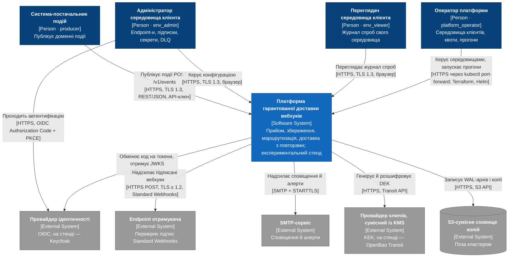
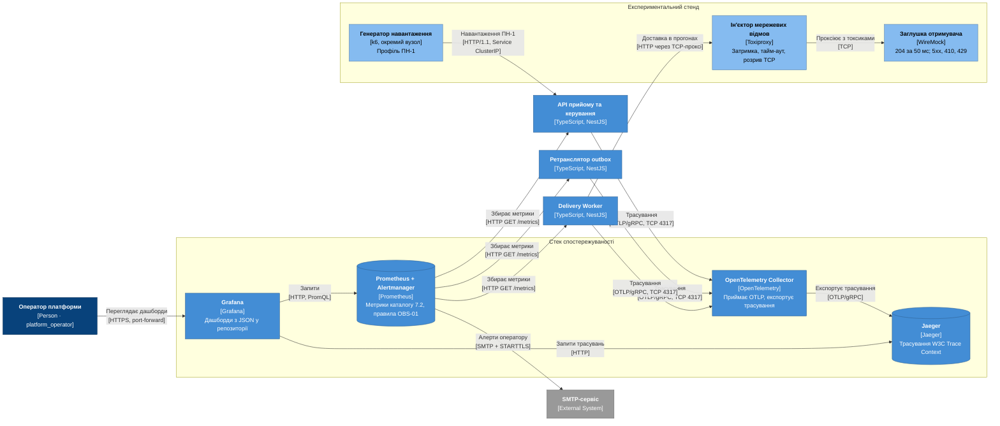
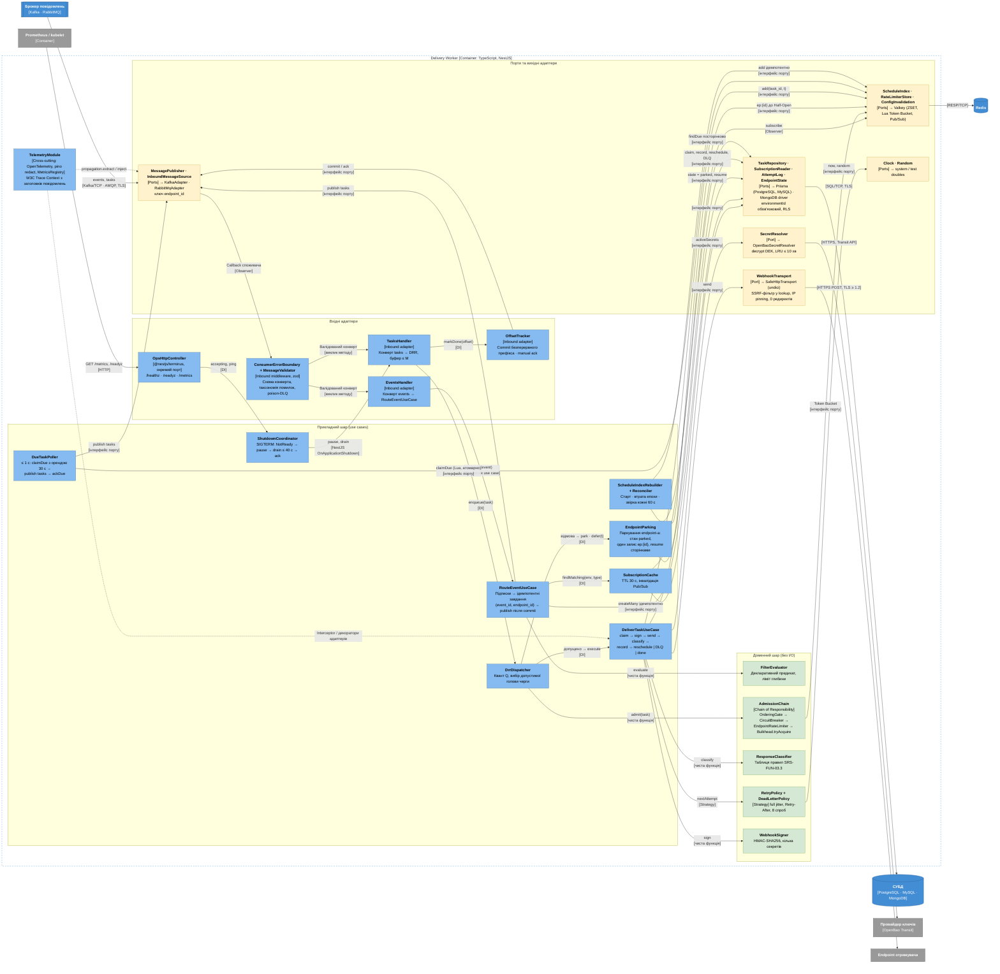

# РОЗДІЛ 2. ПРОЄКТУВАННЯ АРХІТЕКТУРИ ПРОГРАМНОЇ СИСТЕМИ

## 2.1. Контекстне та контейнерне моделювання системи (C4 Model)

Діаграми побудовано за моделлю C4 (Simon Brown) у нотації Mermaid `flowchart` з кольоровим кодуванням C4: темно-синій — особа (Person), синій — система або контейнер, сірий — зовнішня система. Кожен зв'язок має підпис «дія [протокол]». Вихідні вимоги — [SRS](./srs.md).

### 2.1.1. Рівень 1. System Context

**Актори і зовнішні системи**

| Вузол | Тип C4 | Відповідальність | Трасування SRS |
|---|---|---|---|
| Система-постачальник подій | Person | Публікує доменні події через API прийому, автентифікується API-ключем ролі `producer` | [FUN-01.1](./srs.md#srs-fun-01-1)–01.7, [SEC-01](./srs.md#srs-nfr-sec-01) |
| Адміністратор середовища клієнта | Person | Керує endpoint-ами, підписками, секретами, DLQ через портал (`env_admin`) | [FUN-06.1](./srs.md#srs-fun-06-1)–06.2, [FUN-03.6](./srs.md#srs-fun-03-6) |
| Переглядач середовища клієнта | Person | Переглядає журнал спроб свого середовища (`env_viewer`) | [FUN-07.2](./srs.md#srs-fun-07-2) |
| Оператор платформи | Person | Керує середовищами клієнтів і квотами, розгортає стенд, запускає прогони (`platform_operator`) | [FUN-12](./srs.md#srs-fun-12), [EXP-01](./srs.md#srs-exp-01)–04 |
| Платформа гарантованої доставки вебхуків | Software System | Прийом, збереження, маршрутизація, доставка з повторами; експериментальний стенд | розділ 1.2 |
| Endpoint отримувача | External System | Приймає підписані запити, перевіряє підпис | [FUN-03.1](./srs.md#srs-fun-03-1)–03.3, [SEC-04](./srs.md#srs-nfr-sec-04) |
| SMTP-сервіс | External System | Доставляє сповіщення адміністраторам і алерти оператору | [FUN-06.4](./srs.md#srs-fun-06-4), [OBS-01](./srs.md#srs-nfr-obs-01) |
| Провайдер ключів, сумісний із KMS | External System | Зберігає KEK, генерує і розшифровує DEK (на стенді — OpenBao Transit) | [SEC-03](./srs.md#srs-nfr-sec-03), [DC-07](./srs.md#srs-dc-07) |
| Провайдер ідентичності | External System | Автентифікація користувачів порталу за OIDC (на стенді — Keycloak) | [SEC-12](./srs.md#srs-nfr-sec-12) |
| S3-сумісне сховище копій | External System | Зберігає WAL-архів і повні копії поза кластером | [REL-04](./srs.md#srs-nfr-rel-04) (б), [REL-08](./srs.md#srs-nfr-rel-08) |

**Протоколи взаємодії:** вхідні з'єднання — HTTPS з TLS 1.3 ([SEC-02](./srs.md#srs-nfr-sec-02)); доставка вебхуків — HTTPS POST з TLS ≥ 1.2 за специфікацією Standard Webhooks ([SEC-04](./srs.md#srs-nfr-sec-04)); автентифікація порталу — OIDC Authorization Code + PKCE ([SEC-12](./srs.md#srs-nfr-sec-12)); сповіщення — SMTP + STARTTLS; провайдер ключів — HTTPS Transit API; резервні копії — HTTPS S3 API. Оператор звертається до API керування лише через `kubectl port-forward`: маршрути `platform_operator` не публікуються назовні.

### 2.1.2. Рівень 2. Container

```mermaid
flowchart TB
  producer["<b>Система-постачальник подій</b><br/>[Person · producer]"]
  envUser["<b>Адміністратор / переглядач середовища клієнта</b><br/>[Person · env_admin, env_viewer]"]
  operator["<b>Оператор платформи</b><br/>[Person · platform_operator]"]

  subgraph platform["Платформа гарантованої доставки вебхуків [Software System]"]
    direction TB
    subgraph zEdge["Зона входу · NetworkPolicy"]
      ingress["<b>Вхідний контролер</b><br/>[Kubernetes Ingress controller]<br/>TLS 1.3; маршрутизація за хостом; тіло ≤ 256 КБ"]
      portal["<b>Портал адміністрування</b><br/>[TypeScript, Next.js, BFF]<br/>Токени в серверному сеансі"]
    end
    subgraph zApp["Прикладна зона · NetworkPolicy"]
      api["<b>API прийому та керування</b><br/>[TypeScript, NestJS]<br/>Ingestion, Tenancy: валідація, ідемпотентність,<br/>outbox, Token Bucket, RBAC, replay DLQ"]
      relay["<b>Ретранслятор outbox</b><br/>[TypeScript, NestJS]<br/>Polling publisher, ≥ 2 репліки, SKIP LOCKED"]
      scheduler["<b>Планувальник фонових завдань</b><br/>[TypeScript, NestJS; CronJob]<br/>Вимкнення endpoint-ів, сповіщення, строк зберігання"]
      migrate["<b>Міграції схеми</b><br/>[Prisma Migrate; Job]<br/>DDL окремою роллю СУБД"]
    end
    subgraph zEgress["Зона вихідної доставки · egress-політика SEC-14"]
      worker["<b>Delivery Worker</b><br/>[TypeScript, NestJS; KEDA 1–12]<br/>Routing: events → tasks; Delivery: Bulkhead,<br/>Circuit Breaker, DRR, повтори, SSRF-фільтр"]
    end
    subgraph zData["Зона даних · ingress лише з прикладних зон"]
      db[("<b>СУБД</b><br/>[PostgreSQL базова · MySQL · MongoDB RS]<br/>Джерело істини: події, outbox, конфігурація,<br/>стан і розклад завдань, спроби, DLQ, аудит")]
      broker[["<b>Брокер повідомлень</b><br/>[Kafka KRaft, 3 брокери базова · RabbitMQ, 3 вузли]<br/>events, tasks (ключ endpoint_id), poison-DLQ"]]
      redis[("<b>Redis-сумісне сховище</b><br/>[Valkey 9, Lua]<br/>Token Bucket; похідний індекс розкладу;<br/>інвалідація кешу")]
      backup["<b>Резервне копіювання</b><br/>[pgBackRest]<br/>WAL-архів, PITR, 14 діб"]
    end
  end

  subgraph extSys["Зовнішні системи"]
    receiver["<b>Endpoint отримувача</b><br/>[External System]"]
    smtp["<b>SMTP-сервіс</b><br/>[External System]"]
    kms["<b>Провайдер ключів</b><br/>[OpenBao Transit]"]
    idp["<b>Провайдер ідентичності</b><br/>[Keycloak]"]
    s3[("<b>S3-сумісне сховище копій</b><br/>[External System]")]
  end

  producer -- "POST /v1/events<br/>[HTTPS, TLS 1.3, REST/JSON]" --> ingress
  envUser -- "Відкриває портал<br/>[HTTPS, TLS 1.3]" --> ingress
  ingress -- "Ingest і керування<br/>[HTTP/1.1, Service ClusterIP]" --> api
  ingress -- "Запити порталу<br/>[HTTP/1.1, Service ClusterIP]" --> portal
  portal -- "Обмінює код на токени<br/>[HTTPS, OIDC + PKCE]" --> idp
  portal -- "API керування<br/>[HTTP/1.1, REST/JSON, Bearer JWT]" --> api
  operator -- "Середовища клієнтів, квоти<br/>[HTTPS, kubectl port-forward, API-ключ]" --> api
  api -- "JWKS, кеш<br/>[HTTPS]" --> idp
  api -- "Подія + outbox; replay<br/>[SQL/TCP, TLS]" --> db
  api -- "Token Bucket<br/>[RESP/TCP]" --> redis
  api -- "Генерує DEK<br/>[HTTPS, Transit API]" --> kms
  relay -- "Пакет outbox<br/>[SQL/TCP, TLS]" --> db
  relay -- "Публікує events<br/>[Kafka/TCP · AMQP]" --> broker
  worker -- "events → tasks<br/>[Kafka/TCP · AMQP]" --> broker
  worker -- "Завдання, спроби, DLQ<br/>[SQL/TCP, TLS]" --> db
  worker -- "Індекс розкладу<br/>[RESP/TCP]" --> redis
  worker -- "Розшифровує DEK<br/>[HTTPS, Transit API]" --> kms
  worker -- "Доставляє вебхук<br/>[HTTPS POST, TLS ≥ 1.2, Standard Webhooks]" --> receiver
  scheduler -- "Строк зберігання<br/>[SQL/TCP, TLS]" --> db
  scheduler -- "Сповіщає адміністраторів<br/>[SMTP + STARTTLS]" --> smtp
  migrate -- "DDL<br/>[SQL/TCP, TLS]" --> db
  backup -- "WAL<br/>[PostgreSQL replication]" --> db
  backup -- "Записує архів<br/>[HTTPS, S3 API]" --> s3

  classDef person fill:#08427b,stroke:#052e56,color:#fff
  classDef system fill:#1168bd,stroke:#0b4884,color:#fff
  classDef container fill:#438dd5,stroke:#2e6295,color:#fff
  classDef db fill:#438dd5,stroke:#2e6295,color:#fff
  classDef ext fill:#999999,stroke:#6b6b6b,color:#fff
  classDef bench fill:#85bbf0,stroke:#5d82a8,color:#000
  class producer,envUser,operator person
  class ingress,portal,api,relay,worker,scheduler,migrate,backup container
  class db,broker,redis db
  class receiver,smtp,kms,idp,s3 ext
  style platform fill:#ffffff,stroke:#1168bd,stroke-dasharray:5 5
  style extSys fill:#ffffff,stroke:#999999,stroke-dasharray:5 5
```

**Контейнери платформи**

| Контейнер | Технологія | Відповідальність | Трасування SRS |
|---|---|---|---|
| Вхідний контролер | Kubernetes Ingress controller | Термінація TLS 1.3, маршрутизація за хостом (ingest, керування, портал), ліміт тіла 256 КБ | [SEC-02](./srs.md#srs-nfr-sec-02), [FUN-01.1](./srs.md#srs-fun-01-1) |
| Портал адміністрування | TypeScript, Next.js (BFF) | Інтерфейс середовища клієнта; токени зберігаються в серверному сеансі; дії лише через API керування | [FUN-06.1](./srs.md#srs-fun-06-1), [SEC-12](./srs.md#srs-nfr-sec-12) |
| API прийому та керування | TypeScript, NestJS | Контексти Ingestion і Tenancy: валідація JSON Schema, ідемпотентність, транзакція подія + outbox, Token Bucket, RBAC, API ключів, replay DLQ | [FUN-01](./srs.md#srs-fun-01), 05.1, 06, 09, 11, 12, [SEC-01](./srs.md#srs-nfr-sec-01), 11 |
| Ретранслятор outbox | TypeScript, NestJS | Polling publisher; ≥ 2 репліки з `SELECT … FOR UPDATE SKIP LOCKED`; очищення outbox ≤ 24 год | [FUN-02.1](./srs.md#srs-fun-02-1)–02.2, [REL-12](./srs.md#srs-nfr-rel-12), [DC-03](./srs.md#srs-dc-03) |
| Delivery Worker | TypeScript, NestJS; KEDA 1–12 реплік | Модуль Routing (events → tasks) і модуль Delivery (HTTP-доставка, Bulkhead, Circuit Breaker, DRR, повтори full jitter, SSRF-фільтр); ключ партиції `endpoint_id` | [FUN-02.3](./srs.md#srs-fun-02-3)–02.5, 03, 04, 05.2–05.3, 10, 13, [PERF-06](./srs.md#srs-nfr-perf-06) |
| Планувальник фонових завдань | TypeScript, NestJS; Kubernetes CronJob | Автовимкнення endpoint-ів, e-mail сповіщення, повтори сповіщень, строк зберігання, стирання | [FUN-06.3](./srs.md#srs-fun-06-3)–06.4, [REL-15](./srs.md#srs-nfr-rel-15), [SEC-08](./srs.md#srs-nfr-sec-08)–09 |
| Міграції схеми | Prisma Migrate; Kubernetes Job | Застосовує DDL окремою роллю СУБД перед розгортанням | [SEC-10](./srs.md#srs-nfr-sec-10), [MNT-05](./srs.md#srs-nfr-mnt-05) |
| СУБД | PostgreSQL (базова) / MySQL / MongoDB replica set | Джерело істини: події, outbox, конфігурація, стан і розклад завдань, спроби, DLQ завдань, журнал аудиту | [DC-04](./srs.md#srs-dc-04), [REL-10](./srs.md#srs-nfr-rel-10), [SEC-10](./srs.md#srs-nfr-sec-10) |
| Брокер повідомлень | Kafka KRaft, 3 брокери (базова) / RabbitMQ, 3 вузли | Теми `events`, `tasks`, poison-DLQ; RF = 3, `min.insync.replicas` = 2 | [DC-04](./srs.md#srs-dc-04), [REL-05](./srs.md#srs-nfr-rel-05), [FUN-13](./srs.md#srs-fun-13) |
| Redis-сумісне сховище | Valkey 9, Lua ([ADR-001](./adr/0001-choice-of-technology.md)) | Token Bucket; похідний індекс розкладу повторів; канал інвалідації кешу маршрутизації | [DC-05](./srs.md#srs-dc-05), [REL-10](./srs.md#srs-nfr-rel-10), [PERF-07](./srs.md#srs-nfr-perf-07) |
| Резервне копіювання | pgBackRest | WAL-архів (`archive_timeout = 60`), PITR, зберігання 14 діб | [REL-04](./srs.md#srs-nfr-rel-04) (б), [REL-08](./srs.md#srs-nfr-rel-08) |

Сховище і брокер позначено за роллю, а не за продуктом: конкретна технологія — параметр експериментального прогону ([SRS-EXP-01](./srs.md#srs-exp-01)). Межі зон відповідають NetworkPolicy ([SEC-14](./srs.md#srs-nfr-sec-14)): Delivery Worker — єдиний контейнер з виходом до довільних адрес; зона даних приймає з'єднання лише з прикладних зон.

**Протоколи взаємодії**

| Зв'язок | Протокол | Призначення |
|---|---|---|
| Постачальник, користувач → вхідний контролер | HTTPS, TLS 1.3 | Прийом подій, доступ до порталу |
| Вхідний контролер → API, портал | HTTP/1.1, Service ClusterIP | Проксіювання всередині кластера |
| Портал → провайдер ідентичності | HTTPS, OIDC + PKCE | Обмін коду авторизації на токени |
| Портал → API | HTTP/1.1, REST/JSON, Bearer JWT | Виклики API керування |
| Оператор → API | HTTPS, `kubectl port-forward`, API-ключ | Керування середовищами клієнтів і квотами |
| API → провайдер ідентичності | HTTPS | Отримання JWKS з кешуванням |
| API, ретранслятор, воркер, планувальник, міграції → СУБД | SQL/TCP (протокол СУБД), TLS | Транзакції, вибірка outbox, стан завдань, DDL |
| API, воркер → Redis | RESP/TCP 6379 | Token Bucket (`EVALSHA`), індекс розкладу |
| Ретранслятор, воркер → брокер | Kafka protocol TCP 9092 / AMQP 0-9-1 TCP 5671 | Публікація і споживання `events`, `tasks` |
| API, воркер → провайдер ключів | HTTPS, Transit API, Kubernetes auth | API — лише генерація DEK; воркер — лише розшифрування |
| Воркер → endpoint отримувача | HTTPS POST, TLS ≥ 1.2, Standard Webhooks | Доставка вебхука |
| Планувальник → SMTP | SMTP + STARTTLS | Сповіщення адміністраторів |
| pgBackRest → СУБД / S3 | PostgreSQL replication / HTTPS S3 API | WAL-архів і копії |

### 2.1.3. Рівень 2. Container — спостережуваність і експериментальний стенд

| Контейнер | Технологія | Відповідальність | Трасування SRS |
|---|---|---|---|
| OpenTelemetry Collector | OpenTelemetry | Приймає трасування за OTLP, експортує в Jaeger | [FUN-07.4](./srs.md#srs-fun-07-4), [DC-08](./srs.md#srs-dc-08) |
| Jaeger | Jaeger | Зберігає трасування W3C Trace Context | [FUN-07.4](./srs.md#srs-fun-07-4) |
| Prometheus + Alertmanager | Prometheus | Збирає метрики каталогу 7.2 за `/metrics`, виконує правила алертів | [FUN-07.3](./srs.md#srs-fun-07-3), [OBS-01](./srs.md#srs-nfr-obs-01), [EXP-03](./srs.md#srs-exp-03) |
| Grafana | Grafana | Дашборди з JSON у репозиторії; доступ лише оператору | [FUN-07.5](./srs.md#srs-fun-07-5) |
| Генератор навантаження | k6 на окремому вузлі | Профіль ПН-1, ступінчастий і пульсуючий профілі | PERF-01–07, [EXP-02](./srs.md#srs-exp-02) |
| Ін'єктор мережевих відмов | Toxiproxy | TCP-токсики: затримка, тайм-аут, розрив з'єднання | [EXP-04](./srs.md#srs-exp-04), [REL-02](./srs.md#srs-nfr-rel-02)–03 |
| Заглушка отримувача | WireMock | Відповідь 204 за 50 мс; сценарії 5xx, 410, 429 з `Retry-After` | ПН-1, [FUN-03.3](./srs.md#srs-fun-03-3) |

Протоколи: OTLP/gRPC (TCP 4317) — трасування; HTTP GET `/metrics` — збирання метрик Prometheus; HTTP (PromQL) — запити Grafana; SMTP + STARTTLS — алерти Alertmanager; HTTP/1.1 через Service ClusterIP — навантаження k6 в обхід вхідного контролера (PERF-01); TCP — проксіювання Toxiproxy. Логи — stdout контейнерів у форматі JSON із `trace_id` ([SEC-13](./srs.md#srs-nfr-sec-13)); окреме сховище логів не входить до стека [DC-08](./srs.md#srs-dc-08).

## 2.2. Компонентне моделювання критичного сервісу системи

Критичним сервісом обрано **Delivery Worker**: він виконує основне обчислювальне навантаження платформи, реалізує всі механізми стійкості (Bulkhead, Circuit Breaker, DRR, повтори) і є єдиним контейнером з виходом до довільних адрес. Компоненти розміщено за шарами Ports & Adapters ([SRS-DC-02](./srs.md#srs-dc-02)): вхідні адаптери → прикладний шар → доменний шар; доменний шар не має I/O, прикладний шар звертається до інфраструктури лише через порти. Кольори: синій — компоненти адаптерів і прикладного шару, зелений — доменний шар, жовтий — порти з адаптерами.

### 2.2.1. Компоненти

| Компонент | Шар | Відповідальність | Трасування SRS |
|---|---|---|---|
| EventsHandler | Вхідний адаптер | Приймає конверт `events`, викликає `RouteEventUseCase` | [FUN-02.3](./srs.md#srs-fun-02-3) |
| TasksHandler | Вхідний адаптер | Приймає конверт `tasks`, ставить завдання в буфер DRR (≤ M), за заповнення — `pause()` партиції / зменшення `prefetch` | [FUN-04.1](./srs.md#srs-fun-04-1), [FUN-05.3](./srs.md#srs-fun-05-3) |
| ConsumerErrorBoundary + MessageValidator | Вхідний middleware | Валідація схеми конверта (zod); таксономія помилок: poison → poison-DLQ + ack; недоступність СУБД / брокера → без ack, `pause()`, `/readyz` 503; недоступність провайдера ключів → відкладення без збільшення лічильника спроб | [FUN-13](./srs.md#srs-fun-13), [REL-11](./srs.md#srs-nfr-rel-11), [REL-14](./srs.md#srs-nfr-rel-14) |
| OffsetTracker | Вхідний адаптер | Kafka: `enable.auto.commit=false`, commit безперервного префікса завершених offset-ів; RabbitMQ: manual ack | [FUN-10](./srs.md#srs-fun-10), REL-01, [REL-07](./srs.md#srs-nfr-rel-07) |
| OpsHttpController | Вхідний адаптер | Окремий службовий порт: `/healthz`, `/readyz` (СУБД, брокер ≤ 1 с, прапорець прийому), `/metrics`; інших HTTP-маршрутів воркер не має | [REL-16](./srs.md#srs-nfr-rel-16), [FUN-07.3](./srs.md#srs-fun-07-3) |
| RouteEventUseCase | Прикладний | Вибір підписок, ідемпотентне створення завдань за унікальним ключем `(event_id, endpoint_id)`, публікація в `tasks` з ключем `endpoint_id` після фіксації транзакції; ack `events` — після підтвердження брокером; завдання вимкненого endpoint-а — одразу в DLQ | [FUN-02.3](./srs.md#srs-fun-02-3)–02.4, [FUN-06.4](./srs.md#srs-fun-06-4) |
| SubscriptionCache | Прикладний | Кеш підписок і скомпільованих фільтрів: TTL 30 с, інвалідація через Redis Pub/Sub | [PERF-07](./srs.md#srs-nfr-perf-07) |
| DrrDispatcher | Прикладний | Deficit Round Robin між чергами середовищ клієнтів із квантом Q; обирає лише чергу з допустимою головою | [FUN-05.3](./srs.md#srs-fun-05-3) |
| DeliverTaskUseCase | Прикладний | Оркестрація однієї спроби: `claim` → секрети → підпис → надсилання → класифікація → запис спроби → повтор / DLQ / завершення | [FUN-03.1](./srs.md#srs-fun-03-1)–03.6, [FUN-07.1](./srs.md#srs-fun-07-1), [FUN-10](./srs.md#srs-fun-10) |
| DueTaskPoller | Прикладний | Щосекунди захоплює з індексу завдання з орендою 30 с, публікує в `tasks` з ключем `endpoint_id`, після підтвердження брокера знімає запис (P2–P3) | [FUN-03.4](./srs.md#srs-fun-03-4) |
| ScheduleIndexRebuilder + Reconciler | Прикладний | Відновлення індексу під час старту і за втрати ключа епохи; звірка з СУБД кожні 60 с (протокол P5–P6 [ADR-001](./adr/0001-choice-of-technology.md)) | [REL-10](./srs.md#srs-nfr-rel-10), REL-01 |
| EndpointParking | Прикладний | Паркування endpoint-а у стані Open, за блокування порядку або вимкнення: завдання `parked` у СУБД, один запис `ep:{id}` в індексі, відновлення сторінками (P7) | [REL-02](./srs.md#srs-nfr-rel-02), [FUN-04.4](./srs.md#srs-fun-04-4) |
| ShutdownCoordinator | Прикладний | SIGTERM: NotReady → `pause()` консюмерів → очікування спроб ≤ 40 с → commit / ack лише завершених → закриття з'єднань | [REL-07](./srs.md#srs-nfr-rel-07) |
| FilterEvaluator | Доменний | Декларативна мова фільтра (JSON Pointer, порівняння, `in`, `exists`, `and`/`or`/`not`) без `eval` і регулярних виразів; обмеження глибини | [FUN-02.3](./srs.md#srs-fun-02-3), [SEC-18](./srs.md#srs-nfr-sec-18) |
| AdmissionChain | Доменний | Chain of Responsibility: `OrderingGate` → `CircuitBreaker` → `EndpointRateLimiter` → `Bulkhead.tryAcquire`; відмова будь-якої ланки → відкладення без збільшення номера спроби | [FUN-02.5](./srs.md#srs-fun-02-5), [FUN-04.1](./srs.md#srs-fun-04-1)–04.4, [FUN-05.2](./srs.md#srs-fun-05-2) |
| ResponseClassifier | Доменний | Таблиця правил класифікації відповіді: успіх / тимчасова / постійна / постійна з вимкненням endpoint-а | [FUN-03.3](./srs.md#srs-fun-03-3) |
| RetryPolicy + DeadLetterPolicy | Доменний | Strategy: full jitter з урахуванням `Retry-After`; DLQ після 8-ї спроби або постійної відмови | [FUN-03.4](./srs.md#srs-fun-03-4)–03.5 |
| WebhookSigner | Доменний | HMAC-SHA256 за Standard Webhooks; кілька підписів у перехідний період ротації | [SEC-04](./srs.md#srs-nfr-sec-04), [FUN-06.2](./srs.md#srs-fun-06-2) |
| TaskRepository · SubscriptionReader · AttemptLog · EndpointState | Порт → адаптер | Адаптери Prisma (PostgreSQL, MySQL) і драйвера MongoDB; `environmentId` — обов'язковий параметр; RLS для PostgreSQL; СУБД — джерело істини стану і розкладу | [DC-04](./srs.md#srs-dc-04), [REL-10](./srs.md#srs-nfr-rel-10), [SEC-11](./srs.md#srs-nfr-sec-11), [MNT-01](./srs.md#srs-nfr-mnt-01) |
| MessagePublisher · InboundMessageSource | Порт → адаптер | KafkaAdapter (`@confluentinc/kafka-javascript`) і RabbitMqAdapter (`amqplib`, consistent-hash exchange + single active consumer); ключ `endpoint_id` | [DC-04](./srs.md#srs-dc-04), [REL-05](./srs.md#srs-nfr-rel-05), [MNT-01](./srs.md#srs-nfr-mnt-01) |
| ScheduleIndex · RateLimiterStore · ConfigInvalidation | Порт → адаптер | Valkey: ZSET розкладу, Lua Token Bucket, Pub/Sub інвалідації | [DC-05](./srs.md#srs-dc-05), [DC-06](./srs.md#srs-dc-06) |
| SecretResolver | Порт → адаптер | OpenBaoSecretResolver: розшифрування DEK (політика лише `decrypt`), LRU-кеш ≤ 10 хв | [SEC-03](./srs.md#srs-nfr-sec-03), [REL-14](./srs.md#srs-nfr-rel-14) |
| WebhookTransport | Порт → адаптер | SafeHttpTransport (undici): перевірка адреси в `lookup` на рівні з'єднання, фіксація IP, 0 редиректів, тіло ≤ 64 КБ, заголовки ≤ 16 КБ, TLS ≥ 1.2 без вимкнення перевірки | [FUN-04.5](./srs.md#srs-fun-04-5), [SEC-02](./srs.md#srs-nfr-sec-02), [SEC-05](./srs.md#srs-nfr-sec-05) |
| Clock · Random | Порт → адаптер | Системний годинник і генератор; у тестах — керовані дублери | [FUN-03.4](./srs.md#srs-fun-03-4) (тест KS), [FUN-01.4](./srs.md#srs-fun-01-4) |
| TelemetryModule | Наскрізний | OpenTelemetry (`propagation.extract/inject` з заголовків повідомлень, `traceparent` у вебхуку), pino з `redact`, MetricsRegistry каталогу 7.2 | [FUN-07.3](./srs.md#srs-fun-07-3)–07.4, [SEC-13](./srs.md#srs-nfr-sec-13) |

### 2.2.2. Взаємодія компонентів усередині процесу

- **Dependency Injection (NestJS).** Use cases отримують порти через токени ін'єкції (`@Inject(TASK_REPOSITORY)`); модуль адаптерів обирається динамічно (`DatabaseModule.forRoot(driver)`, `BrokerModule.forRoot(kind)`) за параметром прогону [SRS-EXP-01](./srs.md#srs-exp-01), тому заміна СУБД або брокера не змінює прикладного і доменного коду (Dependency Inversion).
- **Інтерфейси портів.** Кожна стрілка «[інтерфейс порту]» — виклик TypeScript-інтерфейсу; контрактні тести портів однакові для всіх адаптерів ([SRS-NFR-MNT-01](./srs.md#srs-nfr-mnt-01)).
- **Чисті функції доменного шару.** `FilterEvaluator`, `AdmissionChain`, `ResponseClassifier`, `RetryPolicy`, `WebhookSigner` не імпортують інфраструктурних пакетів, що забезпечує покриття `src/domain/**` ≥ 80% модульними тестами (SRS-NFR-MNT-03).
- **Observer.** Адаптер брокера викликає зареєстрований callback споживача; `SubscriptionCache` підписаний на канал інвалідації.
- **Chain of Responsibility і Strategy.** Порядок допуску фіксований ланцюжком `AdmissionChain`; політика повторів замінна стратегією без зміни `DeliverTaskUseCase`.
- **Спорідненість стану.** Стан Circuit Breaker, Bulkhead і DRR зберігається в пам'яті репліки; коректність забезпечує інваріант «завдання одного endpoint-а обробляє одна репліка» (ключ `endpoint_id`: партиція Kafka або consistent-hash черга RabbitMQ з single active consumer).

### 2.2.3. Безпека на рівні коду сервісу

Delivery Worker не має користувацьких HTTP-маршрутів, тому JWT-guard і RBAC до нього не застосовуються: автентифікація і авторизація виконуються в API прийому та керування. Захист воркера забезпечують: перевірка відповідності `environmentId` події, endpoint-а і завдання з RLS ([SEC-11](./srs.md#srs-nfr-sec-11)); SSRF-фільтр у транспорті ([SEC-05](./srs.md#srs-nfr-sec-05)); безпечне виконання фільтра підписки; маскування payload і секретів у логах і спанах ([SEC-13](./srs.md#srs-nfr-sec-13)); окремі облікові записи воркера в брокері, Redis і СУБД з мінімальними правами (налаштовуються в Helm-чартах); службовий порт доступний лише з простору імен Prometheus за NetworkPolicy.

## 2.3. Документування архітектурних рішень (Architecture Decision Records)

| ADR | Рішення | Статус | Вимоги | Елементи C4 |
|---|---|---|---|---|
| [ADR-001](./adr/0001-choice-of-technology.md) | Механізм планування відкладених спроб: індекс розкладу у Valkey + СУБД як джерело істини + звірка; паркування endpoint-а | Approved | [SRS-DC-06](./srs.md#srs-dc-06), [SRS-NFR-REL-10](./srs.md#srs-nfr-rel-10), [SRS-FUN-03.4](./srs.md#srs-fun-03-4), [SRS-NFR-REL-02](./srs.md#srs-nfr-rel-02) | [L2](#diagram-level2): Delivery Worker, Redis-сумісне сховище; [L3](#diagram-level3): DueTaskPoller, ScheduleIndexRebuilder + Reconciler, EndpointParking |

## 2.4. UML-моделі

## 2.5. Схема даних

## 2.6. Алгоритми критичних вузлів
