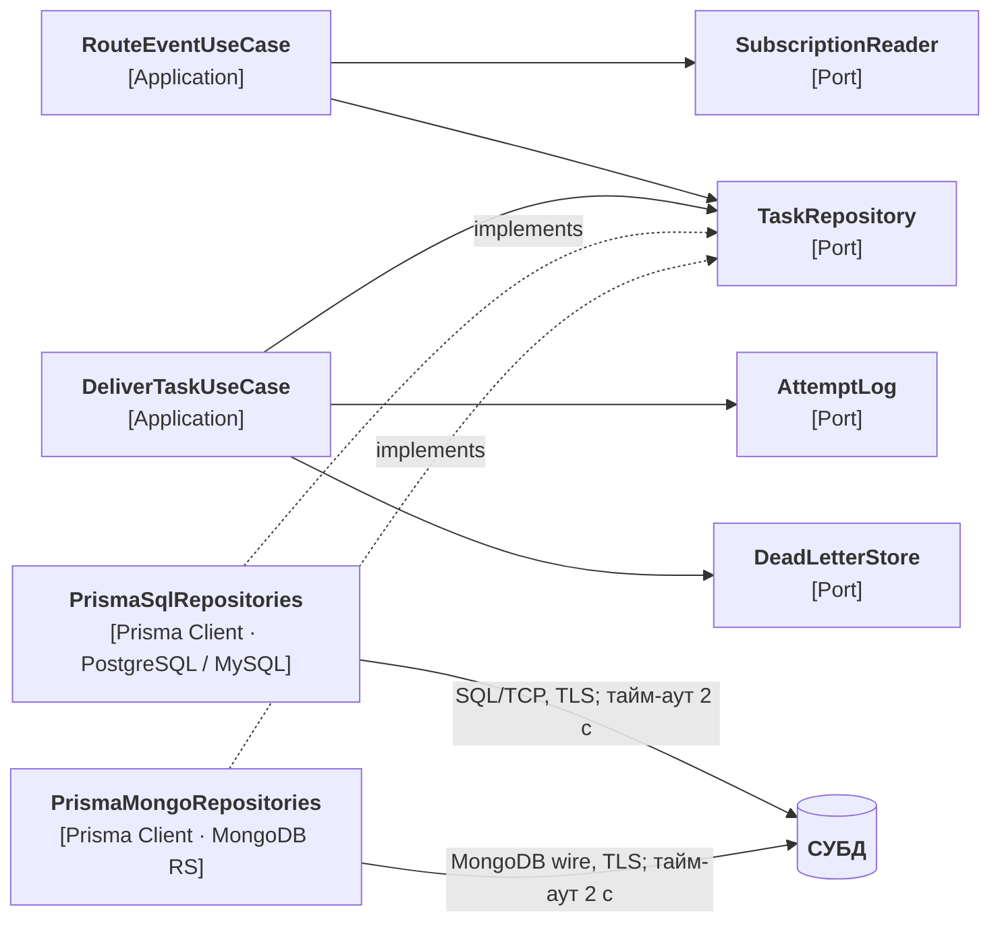
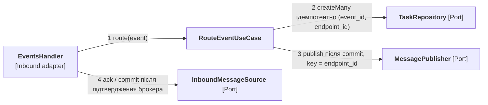
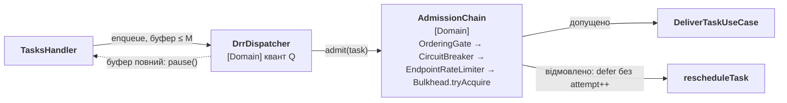
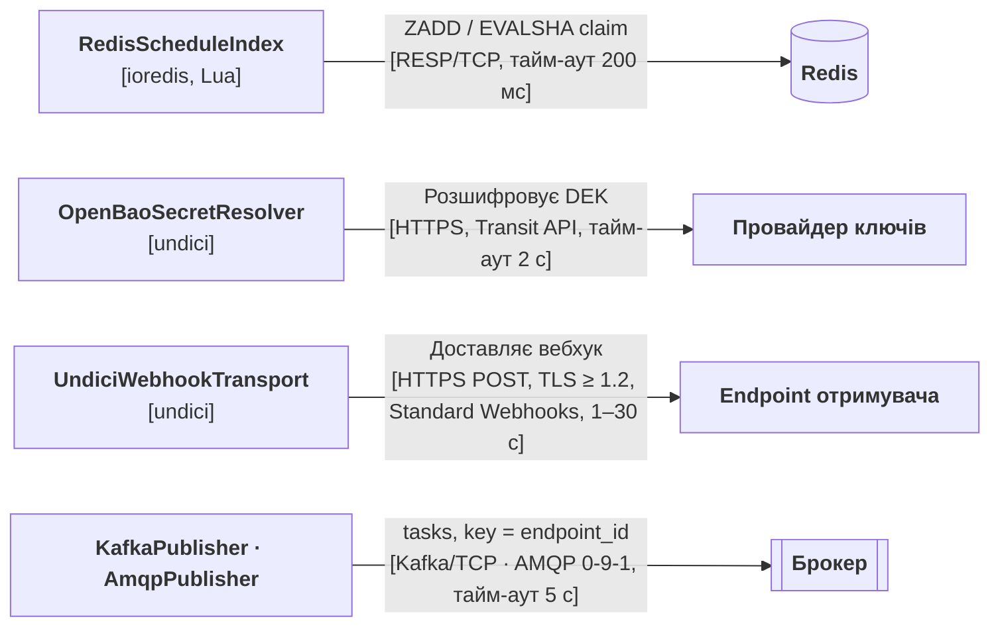
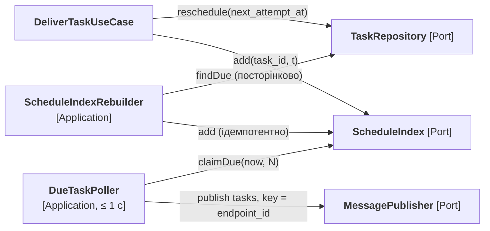
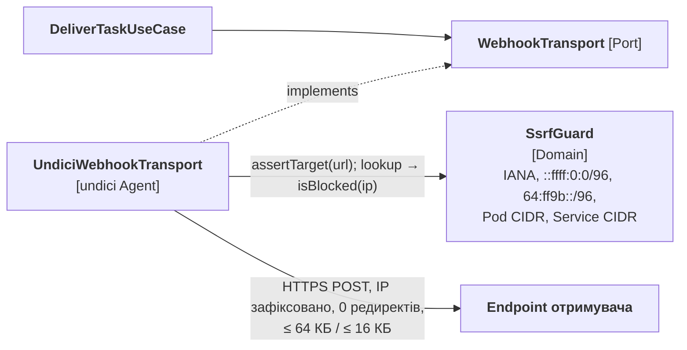
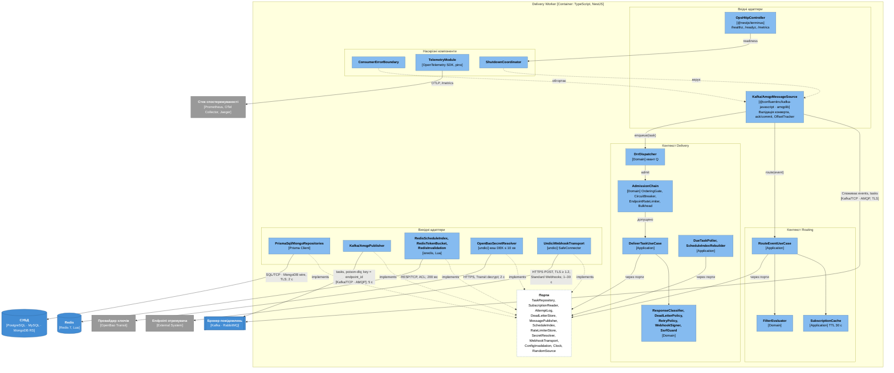

# Звіт Code Review діаграми C4 рівня 3 (Component): Delivery Worker

**Об'єкт перевірки:** `c4/l3_v1.mmd` — діаграма компонентів контейнера Delivery Worker
**Контекст:** `c4/l2_v1.mmd` (діаграма контейнерів), SRS платформи гарантованої доставки вебхуків, версія 1.0
**Критерії:** 1 — порушення шарів (Clean Architecture); 2 — патерни, типи зв'язків, SOLID; 3 — повнота інженерного пайплайну; 4 — безпека на рівні коду сервісу
**Дата:** 2026-11-18

## 0. Умови перевірки

### 0.1. Шкала критичності

| Позначка | Рівень | Критерій |
|---|---|---|
| К | Критично | Діаграма суперечить вимозі Must або приховує нерозв'язане рішення, від якого залежить виконання вимоги Must |
| В | Високо | Відсутній компонент або зв'язок, необхідний для трасування вимоги Must; порушення правила залежностей Ports & Adapters (SRS-DC-02) |
| С | Середньо | Відсутнє трасування вимоги Should; неповний або неоднозначний опис компонента чи зв'язку |
| Н | Низько | Нотація C4, ідентифікатори, узгодженість підписів |

### 0.2. Обмеження, враховані в рекомендаціях

- Проєкт виконує один розробник; один кластер Kubernetes (SRS 2.4).
- Рекомендації обмежено стеком SRS-DC-01…09 і розділу 8. Не запропоновано: OWASP ZAP, Chaos Mesh, Kyverno, HashiCorp Vault, service mesh, окремий вихідний проксі, розподілений координатор стану.
- Кожен новий компонент рекомендацій — модуль або клас усередині наявного контейнера; нових контейнерів рівня 2 звіт не вводить.

### 0.3. Модель загроз і вхідних інтерфейсів контейнера

| Вхід | Ініціатор | Довірча межа | Механізм контролю |
|---|---|---|---|
| Повідомлення теми `events` | Ретранслятор outbox через брокер | Брокер (зона даних) | Автентифікація й ACL брокера; валідація конверта повідомлення |
| Повідомлення теми `tasks` | Delivery Worker (Routing, повтори) через брокер | Брокер | Те саме |
| HTTP `/healthz`, `/readyz`, `/metrics` | kubelet, Prometheus | Кластерна мережа | NetworkPolicy; відсутність бізнес-маршрутів |
| HTTP-відповідь endpoint-а отримувача | Зовнішня система | Інтернет (вихідна зона, SRS-NFR-SEC-14) | Ліміти розміру, тайм-аут, класифікація |

Delivery Worker не приймає HTTP-запитів від користувачів. Висновок щодо JWT/RBAC-guard'ів наведено в розділі 4.0.

### 0.4. Формат зауваження

**Фрагмент** — компонент або зв'язок діаграми; **Підстава** — пункт SRS або правило; **Проблема**; **Виправлення** — опис і за потреби фрагмент Mermaid або коду. Фрагменти Mermaid є вставками до `l3_v1.mmd`; повна виправлена структура — у Додатку А.

### 0.5. Відповідні елементи діаграми

| Елемент | Висновок |
|---|---|
| `eventsConsumer → router`, `tasksConsumer → drr` | Вхідні адаптери викликають прикладні сервіси, а не СУБД; обходу бізнес-логіки з боку споживачів немає |
| `httpClient → receiver` | Вихідний HTTP ізольовано в окремому компоненті |
| `cb`, `bulkhead`, `drr`, `retry` | Патерни стійкості виділено в окремі компоненти, а не вбудовано в `DeliveryService` |
| Зовнішні елементи | Набір збігається із зв'язками `worker` на рівні 2 |

---

## 1. Порушення шарів (Clean Architecture)

### C1-01 · К · Прикладні сервіси залежать від конкретного адаптера СУБД

- **Фрагмент:** `router --> prisma`, `delivery --> prisma`, `prisma --> db`; компонент `PrismaService [Prisma Client]`.
- **Підстава:** SRS-DC-02 (Ports & Adapters), SRS-DC-04 (СУБД через спільний порт репозиторію), SRS-NFR-MNT-01 (єдиний набір контрактних тестів порту для PostgreSQL, MySQL, MongoDB), SRS-EXP-01.
- **Проблема:**
  1. Між прикладними сервісами і Prisma Client відсутній шар портів. `RoutingService` і `DeliveryService` залежать від класу інфраструктури, що прямо порушує правило залежностей: внутрішнє коло посилається на зовнішнє.
  2. Порт репозиторію, через який SRS-DC-04 вимагає підключати три СУБД, на діаграмі не існує. Контрактні тести SRS-NFR-MNT-01 не мають об'єкта: тестується порт, а не `PrismaService`.
  3. Один компонент `PrismaService` обслуговує обидва обмежені контексти і всі агрегати (підписки, завдання, спроби, DLQ) — порушення ISP; зміна схеми одного контексту зачіпає інший.
  4. Провайдер `datasource` у `schema.prisma` задається статичним рядком. Для PostgreSQL/MySQL і MongoDB потрібні окремі схеми й окремо згенеровані клієнти; моделі MongoDB (документи, відсутність `SKIP LOCKED`) відрізняються від SQL. Без порту ці відмінності протікають у прикладний код.
- **Виправлення:** ввести вихідні порти за агрегатами і адаптери під кожну СУБД. Прикладні сервіси залежать лише від портів.



### C1-02 · К · Компоненти прив'язано до клієнта Kafka

- **Фрагмент:** `eventsConsumer [NestJS, @confluentinc/kafka-javascript]`, `producer [KafkaProducer, @confluentinc/kafka-javascript]`, `router --> producer`.
- **Підстава:** SRS-DC-04 (брокери Kafka і RabbitMQ через спільний порт брокера), SRS-EXP-01 (брокер — параметр експерименту), SRS-NFR-MNT-01, SRS-NFR-REL-05.
- **Проблема:** діаграма описує лише конфігурацію Kafka. Адаптерів `amqplib` немає; `RoutingService` залежить від `KafkaProducer` за назвою і технологією. Перемикання брокера вимагає зміни прикладного коду, що робить параметр експерименту SRS-EXP-01 неконтрольованим (у різних прогонах змінюється не лише брокер, а й код маршрутизації). Семантика підтвердження (offset commit у Kafka, ack/nack у RabbitMQ) не абстрагована (див. C3-01).
- **Виправлення:**
  - вхідний порт `InboundMessageSource` з повідомленням виду `{ key, headers, payload, ack(), nack(requeue) }`; адаптери `KafkaMessageSource` (`@confluentinc/kafka-javascript`) і `AmqpMessageSource` (`amqplib`, manual ack, `prefetch`);
  - вихідний порт `MessagePublisher.publish(topic, key, message)`; адаптери з `acks=all` + ідемпотентний продюсер (Kafka) і publisher confirms (RabbitMQ) за SRS-NFR-REL-05;
  - перейменувати `EventsConsumer`/`TasksConsumer` у тонкі обробники (`EventsHandler`, `TasksHandler`), які не залежать від клієнта брокера.

### C1-03 · К · `RetryScheduler` записує розклад лише в Redis в обхід джерела істини

- **Фрагмент:** `retry["RetryScheduler … запис у Redis ZSET"]`, `retry --> redis`; відсутній зв'язок `retry → СУБД`.
- **Підстава:** SRS-NFR-REL-10 (джерело істини стану завдання і часу наступної спроби — СУБД; Redis — похідний індекс), SRS-DC-06, SRS-NFR-REL-01, інваріант 8.2.
- **Проблема:**
  1. Діаграма фіксує протилежну до SRS-NFR-REL-10 модель: час наступної спроби існує лише в ZSET. Після втрати даних Redis (сценарій RTM: `FLUSHALL` під навантаженням) завдання, що очікують повтору, втрачаються, інваріант 8.2 порушується.
  2. Доменна політика повтору (full jitter, SRS-FUN-03.4) і інфраструктурний запис у Redis об'єднано в одному компоненті.
- **Виправлення:** розділити на `RetryPolicy` (Domain, чиста функція `nextDelay(attempt, retryAfter, rnd)`) і прикладний крок `rescheduleTask`: спочатку `TaskRepository.reschedule(taskId, nextAttemptAt, attempt)` у СУБД, потім `ScheduleIndex.add(taskId, nextAttemptAt)` через порт з адаптером `RedisScheduleIndex`. Помилка запису в Redis не скасовує повтор (індекс відновлюється, C3-02). Порядок операцій зафіксувати в ADR за SRS-DC-06.

### C1-04 · К · Подвійний запис у `RoutingService` без атомарності та ідемпотентності

- **Фрагмент:** `router --> prisma` і `router --> producer -- "tasks" --> broker`.
- **Підстава:** SRS-FUN-02.4 (одне завдання на пару подія–endpoint), SRS-FUN-10 (at-least-once), SRS-NFR-REL-01 (0 втрат за відмови pod-а воркера), SRS-DC-03.
- **Проблема:** маршрутизація виконує два незалежні записи: стан завдання в СУБД і повідомлення в `tasks`. Діаграма не визначає ні їх порядку, ні моменту підтвердження повідомлення `events`. Відмова pod-а між записами дає один із двох станів: завдання в СУБД без повідомлення (доставка не почнеться — порушення інваріанту 8.2) або повторну маршрутизацію з дублікатами завдань (порушення SRS-FUN-02.4). Transactional Outbox (SRS-DC-03) застосовано лише на межі прийому; на межі Routing → Delivery механізм атомарності відсутній.
- **Виправлення (без нового контейнера):**
  1. Унікальний ключ `(event_id, endpoint_id)`; `TaskRepository.createMany` — ідемпотентна вставка (`ON CONFLICT DO NOTHING` / `INSERT IGNORE` / `upsert`), що повертає всі завдання пари, включно з наявними.
  2. Публікація в `tasks` (ключ `endpoint_id`) — після фіксації транзакції; підтвердження `events` — лише після підтвердження брокером усіх публікацій.
  3. Повторна обробка того самого `events` після відмови повторює публікацію наявних завдань; дублікати повідомлень `tasks` відсікає перевірка стану завдання в `DeliverTaskUseCase` (C3-02).
  4. Альтернатива — запис завдань в outbox і публікація наявним ретранслятором; вибір зафіксувати в ADR.



### C1-05 · В · `DeliveryService` — вузол зі змішаними відповідальностями

- **Фрагмент:** `delivery["DeliveryService … Доставка, класифікація відповіді, DLQ"]` і шість вихідних зв'язків: `bulkhead`, `cb`, `signer`, `httpClient`, `prisma`, `retry`.
- **Підстава:** SRP, OCP; SRS-FUN-03.3 (таблиця класифікації), SRS-FUN-03.5 (DLQ), SRS-FUN-07.1 (запис спроби), SRS-NFR-MNT-03 (покриття доменних модулів ≥ 80%).
- **Проблема:** один компонент виконує оркестрацію спроби, класифікацію відповіді, рішення про DLQ, запис спроби, вимкнення endpoint-а за 410 (SRS-FUN-03.3) і керування повтором. Ступінь виходу 6 — максимальний на діаграмі; усі зміни політик доставки проходять через один клас. Доменні правила (класифікація, ліміт 8 спроб) не відокремлені від I/O, тому покриття `src/domain/**` за SRS-NFR-MNT-03 не досягається без інтеграційних тестів.
- **Виправлення:** розділити на:

| Компонент | Шар | Відповідальність | Вимоги |
|---|---|---|---|
| `DeliverTaskUseCase` | Application | Оркестрація однієї спроби; єдина точка I/O через порти | FUN-03.1, FUN-10 |
| `ResponseClassifier` | Domain | Чиста функція: код / помилка → `Success \| Transient \| Permanent \| PermanentDisable` | FUN-03.3 |
| `DeadLetterPolicy` | Domain | Рішення «повтор / DLQ» за номером спроби і класом | FUN-03.5 |
| `AttemptLog` | Port | Запис спроби з полями SRS-FUN-07.1, перші 1 КБ тіла | FUN-07.1 |
| `EndpointStatePort` | Port | Переведення endpoint-а в `disabled` за 410 | FUN-03.3 |

Таблицю класифікації реалізувати як дані (масив правил), а не як розгалуження у сервісі; розширення класу відповіді не змінює `DeliverTaskUseCase`.

### C1-06 · С · Межі контекстів Routing і Delivery та шари не відображено

- **Фрагмент:** усі 12 компонентів в одному `subgraph worker` без групування.
- **Підстава:** SRS-DC-02 (межі модулів перевіряються fitness functions dependency-cruiser), SRS-NFR-MNT-03 (шлях `src/domain/**`).
- **Проблема:** діаграма не показує, які компоненти належать Routing, а які Delivery, і який шар кожен займає. Правила dependency-cruiser неможливо вивести з діаграми; спільний `PrismaService` і `KafkaProducer` створюють неявну залежність між контекстами. Контрактом між контекстами має бути лише повідомлення `tasks`.
- **Виправлення:** групувати компоненти у вкладені `subgraph` за контекстом і шаром (Додаток А); зафіксувати правила:

```js
// .dependency-cruiser.cjs (фрагмент)
module.exports = {
  forbidden: [
    { name: 'domain-is-pure', severity: 'error',
      from: { path: '^src/domain/' },
      to: { path: '^src/(application|infrastructure|adapters)/|node_modules/(@nestjs|@prisma|ioredis|undici|@confluentinc|amqplib)' } },
    { name: 'application-uses-ports-only', severity: 'error',
      from: { path: '^src/application/' },
      to: { path: '^src/(infrastructure|adapters)/|node_modules/(@prisma|ioredis|undici|@confluentinc|amqplib)' } },
    { name: 'routing-not-to-delivery', severity: 'error',
      from: { path: '^src/(domain|application)/routing/' },
      to: { path: '^src/(domain|application)/delivery/' } },
    { name: 'delivery-not-to-routing', severity: 'error',
      from: { path: '^src/(domain|application)/delivery/' },
      to: { path: '^src/(domain|application)/routing/' } },
  ],
};
```

### C1-07 · В · `Signer` виконує мережевий виклик до провайдера ключів

- **Фрагмент:** `signer["Signer [node:crypto] HMAC-SHA256"]`, `signer --> kms`; відсутнє джерело зашифрованого секрету.
- **Підстава:** SRS-NFR-SEC-04 (перевірка тестовими векторами Standard Webhooks), SRS-FUN-06.2 (два підписи в перехідний період ротації), SRS-NFR-SEC-03, SRS-NFR-REL-14 (кеш DEK ≤ 10 хв; за недоступності провайдера ключів — відкладення без збільшення лічильника спроб).
- **Проблема:**
  1. Компонент обчислення HMAC (чиста функція над байтами) залежить від зовнішньої системи. Перевірка тестовими векторами SRS-NFR-SEC-04 вимагає підняття OpenBao або заглушки HTTP.
  2. Ланцюг отримання секрету неповний: зашифрований секрет endpoint-а зберігається в СУБД, зашифрований DEK — поруч із ним; діаграма не показує читання цих даних, кеш DEK і поведінку за недоступності провайдера ключів.
  3. Сигнатура «один секрет → один підпис» не покриває SRS-FUN-06.2.
- **Виправлення:**
  - `WebhookSigner` (Domain): `sign(msgId, timestamp, body, secrets[]): string` — повертає підписи всіма активними секретами через пробіл;
  - порт `SecretResolver.activeSecrets(endpointId): Promise<Secret[]>`; адаптер `OpenBaoSecretResolver` читає зашифровані значення через `EndpointSecretReader` (порт СУБД), розшифровує DEK через Transit API, кешує DEK у пам'яті ≤ 10 хв;
  - помилка `KeyProviderUnavailable` у `DeliverTaskUseCase` → відкладення завдання без збільшення номера спроби (SRS-NFR-REL-14), а не тимчасова відмова доставки.

---

## 2. Патерни, типи зв'язків, SOLID

### C2-01 · В · Інверсію залежностей не відображено і не забезпечено механізмом DI

- **Фрагмент:** усі внутрішні стрілки вказують на конкретні класи (`PrismaService`, `KafkaProducer`, `HttpClient [undici]`, Redis).
- **Підстава:** DIP; SRS-DC-02, SRS-DC-04, SRS-NFR-MNT-01.
- **Проблема:** на діаграмі немає жодного інтерфейсу (порту) і жодного зв'язку «реалізує». Інжекція класів через конструктор NestJS без токена інтерфейсу є Service Locator у межах контейнера DI, а не інверсією залежностей: модуль верхнього рівня імпортує модуль нижнього. Принцип LSP для адаптерів (PostgreSQL / MySQL / MongoDB, Kafka / RabbitMQ) не має точки перевірки.
- **Виправлення:** порти — інтерфейси з токенами ін'єкції в шарі Application; вибір адаптера — у composition root через динамічні модулі за конфігурацією прогону. Набір контрактних тестів SRS-NFR-MNT-01 виконується проти порту для кожного адаптера і є перевіркою LSP.

```ts
// src/application/delivery/ports/task-repository.port.ts
export const TASK_REPOSITORY = Symbol('TASK_REPOSITORY');
export interface TaskRepository {
  createMany(tasks: NewTask[]): Promise<TaskRef[]>;                 // ідемпотентно за (event_id, endpoint_id)
  claim(id: TaskId, leaseUntil: Date): Promise<TaskSnapshot | null>; // null — термінальний стан або не настав час
  reschedule(id: TaskId, nextAttemptAt: Date, attempt: number): Promise<void>;
  moveToDlq(id: TaskId, reason: DlqReason): Promise<void>;
  findDue(until: Date, limit: number, after?: TaskId): Promise<TaskRef[]>; // відновлення індексу, SRS-NFR-REL-10
}

// src/infrastructure/persistence/persistence.module.ts
@Module({})
export class PersistenceModule {
  static forRoot(kind: 'postgres' | 'mysql' | 'mongodb'): DynamicModule {
    const impl = kind === 'mongodb' ? PrismaMongoTaskRepository : PrismaSqlTaskRepository;
    return {
      module: PersistenceModule,
      global: true,
      providers: [{ provide: TASK_REPOSITORY, useClass: impl }],
      exports: [TASK_REPOSITORY],
    };
  }
}

// src/application/delivery/deliver-task.use-case.ts
@Injectable()
export class DeliverTaskUseCase {
  constructor(
    @Inject(TASK_REPOSITORY) private readonly tasks: TaskRepository,
    @Inject(WEBHOOK_TRANSPORT) private readonly transport: WebhookTransport,
    @Inject(CLOCK) private readonly clock: Clock,
  ) {}
}
```

### C2-02 · К · Стан Circuit Breaker, Bulkhead і DRR у пам'яті репліки без гарантії спорідненості endpoint-а з реплікою

- **Фрагмент:** `cb["CircuitBreaker [клас, стан у пам'яті]"]`, `bulkhead["Bulkhead [p-limit на endpoint]"]`, `drr`; контейнер масштабується KEDA 1–12 реплік (рівень 2); ключ `endpoint_id` для `tasks` на рівні 3 не вказано.
- **Підстава:** SRS-FUN-04.1 (ліміт одночасних запитів до одного endpoint-а), SRS-FUN-04.2–04.3, SRS-FUN-05.3, SRS-NFR-REL-02, SRS-NFR-PERF-06, SRS-EXP-01.
- **Проблема:** стан у пам'яті коректний лише тоді, коли всі завдання одного endpoint-а обробляє одна репліка.
  - Kafka: умова виконується за ключа `endpoint_id` (одна партиція — один споживач групи), окрім вікна ребалансування. Діаграма не показує, що ключ встановлюється на продюсері `tasks` і на повторних публікаціях.
  - RabbitMQ: за конкуруючих споживачів однієї черги завдання endpoint-а розподіляються між усіма репліками. Фактичний ліміт Bulkhead дорівнює `limit × кількість реплік`, кожна репліка має власний Circuit Breaker з неповним вікном 20 спроб. SRS-FUN-04.1 і SRS-FUN-04.2 порушуються в половині конфігурацій SRS-EXP-01.
  - DRR розподіляє слоти лише в межах репліки; глобальна справедливість SRS-FUN-05.3 є наближенням, яке не зафіксовано.
- **Виправлення:**
  1. Зафіксувати в ADR інваріант «завдання endpoint-а обробляє одна репліка» і показати на діаграмі ключ `endpoint_id` на зв'язках публікації `tasks`.
  2. RabbitMQ: 12 quorum-черг `tasks.0…tasks.11` за consistent-hash exchange (плагін `rabbitmq_consistent_hash_exchange`, ключ маршрутизації `endpoint_id`) з `x-single-active-consumer: true`; число черг дорівнює числу партицій Kafka (SRS-NFR-PERF-06), що вирівнює конфігурації експерименту.
  3. Kafka: у `rebalance_cb` перед відкликанням партицій очікувати завершення незавершених спроб (обмежено тайм-аутом, меншим за `terminationGracePeriodSeconds`), стан Circuit Breaker після переходу партиції починати з Closed; відхилення задокументувати.
  4. Перенесення стану в Redis не рекомендовано: додає мережевий виклик на кожну спробу і робить доставку залежною від Redis.

### C2-03 · В · Порядок політик стійкості: DRR виділяє слот до перевірок допуску

- **Фрагмент:** `tasksConsumer --> drr --> delivery --> bulkhead`, `delivery --> cb`.
- **Підстава:** SRS-FUN-04.1 (завдання понад ліміт не займають слотів обробки інших endpoint-ів), SRS-FUN-04.4, SRS-FUN-05.2, бюджет 1 ГБ RAM (розділ 5.0), SRS-NFR-REL-02.
- **Проблема:**
  1. DRR передає завдання в `DeliveryService`, і лише там застосовуються Bulkhead і Circuit Breaker. Завдання endpoint-а з вичерпаним лімітом утримує вже виділений DRR-слот в очікуванні `p-limit` — пряме порушення SRS-FUN-04.1.
  2. Черга очікування `p-limit` необмежена; за недоступного endpoint-а (сценарій SRS-NFR-REL-02, 80% трафіку) у пам'яті накопичуються завдання, що загрожує OOM у межах бюджету 5.0.
  3. Діаграма не задає порядку політик; зв'язки `delivery → cb` і `delivery → bulkhead` рівноправні, хоча порядок визначає поведінку SRS-FUN-04.4 (відкладення без лічильника спроб).
- **Виправлення:** допуск виконується в DRR під час вибору черги: обирається лише черга середовища клієнта, голова якої допустима. Порядок перевірок — ланцюжок відповідальності (GoF Chain of Responsibility): `OrderingGate → CircuitBreaker → EndpointRateLimiter → Bulkhead.tryAcquire` (без очікування); відмова будь-якої ланки → відкладення без збільшення номера спроби. Обсяг буфера на репліку обмежити; за заповнення — `pause()` партиції / зменшення `prefetch` замість накопичення.



### C2-04 · С · Відсутні порти годинника і генератора випадкових чисел

- **Фрагмент:** `retry` (full jitter), `cb` (60 с у стані Open), кеш DEK (≤ 10 хв).
- **Підстава:** RTM 8.1 для SRS-FUN-03.4 («інжектовані порти годинника і генератора випадкових чисел»; критерій Колмогорова–Смирнова), SRS-FUN-04.3, SRS-NFR-REL-14.
- **Проблема:** метод верифікації SRS прямо вимагає портів `Clock` і `RandomSource`; на діаграмі їх немає. Доменні компоненти з `Date.now()` і `Math.random()` не перевіряються модельним тестуванням `fc.commands` (SRS-FUN-04.1–04.4).
- **Виправлення:** порти `Clock.now()` і `RandomSource.next()` у шарі Domain/Application; адаптери `SystemClock`, `CryptoRandom` (`crypto.randomInt`); тестові реалізації — у тестах. На діаграмі — один компонент «Clock, RandomSource [Port]» із зв'язками від `RetryPolicy`, `CircuitBreaker`, `SecretResolver`.

### C2-05 · С · Зв'язки без опису, технології, тайм-аутів і типу взаємодії

- **Фрагмент:** 15 із 18 стрілок без підпису; підписи наявних — лише назва теми (`"events"`, `"tasks"`).
- **Підстава:** нотація C4 (зв'язок має опис і технологію); SRS-NFR-REL-13 і розділ 7.1 (тайм-аути СУБД 2 с, Redis 200 мс, брокер 5 с, провайдер ключів 2 с); SRS-FUN-03.1 (тайм-аут доставки 1–30 с).
- **Проблема:** неможливо визначити синхронний виклик, асинхронне повідомлення чи реалізацію інтерфейсу; зовнішні зв'язки не мають протоколу, хоча на рівні 2 протоколи вказано. Тайм-аути SRS-NFR-REL-13 не трасуються.
- **Виправлення:** конвенція: суцільна стрілка — синхронний виклик методу (підпис — операція); суцільна стрілка з протоколом — мережевий виклик із тайм-аутом; пунктирна `-. "implements" .->` — реалізація порту; асинхронні повідомлення — підпис із темою і ключем.



### C2-06 · Н · Напрямок стрілок брокера не узгоджено з рівнем 2

- **Фрагмент:** `broker -- "events" --> eventsConsumer`, `broker -- "tasks" --> tasksConsumer`; на рівні 2 — `worker → broker`.
- **Підстава:** нотація C4 (напрямок — від ініціатора взаємодії); узгодженість рівнів.
- **Проблема:** споживач ініціює з'єднання і запит вибірки; стрілка від брокера показує потік даних, а решта стрілок діаграми — залежність. Змішування двох семантик у одній діаграмі.
- **Виправлення:** `msgSource -- "Споживає events, tasks [Kafka/TCP · AMQP]" --> broker`.

### C2-07 · Н · Ідентифікатори, типи елементів і підписи технологій

- **Фрагмент:** `producer` (ідентифікатор `KafkaProducer` збігається з `producer` — Person на рівні 2); `tasksConsumer [NestJS]` без клієнта брокера; `cb [клас, стан у пам'яті]`; `bulkhead [p-limit на endpoint]`.
- **Підстава:** нотація C4 (кожен компонент — назва, `[Component: технологія]`, відповідальність).
- **Проблема:** колізія ідентифікаторів ускладнює зведення діаграм; поле технології містить відомості про реалізацію (`стан у пам'яті`) замість технології і шару; `p-limit` очікує в черзі, тоді як Bulkhead за C2-03 має відмовляти без очікування.
- **Виправлення:** ідентифікатори з префіксом шару (`inMsg`, `appDeliver`, `domCb`, `outPub`); формат підпису `[Component: Domain, TypeScript]`; Bulkhead — власний лічильник `Map<endpointId, inFlight>` з `tryAcquire()/release()` і лімітом з конфігурації endpoint-а (1–100).

---

## 3. Повнота інженерного пайплайну

### C3-01 · К · Керування підтвердженням повідомлень (ack / commit) відсутнє

- **Фрагмент:** `tasksConsumer --> drr --> delivery`; жодного компонента або зв'язку підтвердження.
- **Підстава:** SRS-FUN-10, SRS-NFR-REL-01, SRS-NFR-REL-07 (незавершені завдання повертаються брокеру без підтвердження), інваріант 8.2.
- **Проблема:** DRR буферизує завдання в пам'яті і видає їх не в порядку надходження. У Kafka offset фіксується на партицію послідовно: автоматичний commit або commit останнього обробленого offset-а підтверджує й ті завдання, що ще в буфері; відмова pod-а втрачає їх. Діаграма не визначає, коли повідомлення вважається обробленим.
- **Виправлення:**
  1. Правило підтвердження: повідомлення `tasks` підтверджується, коли завдання досягло термінального стану або його наступну спробу зафіксовано в СУБД (C1-03). Повідомлення `events` — за C1-04.
  2. Kafka: `enable.auto.commit=false`; компонент `OffsetTracker` на партицію фіксує найбільший offset, до якого всі попередні повідомлення завершені (commit безперервного префікса).
  3. RabbitMQ: manual ack на повідомлення; `prefetch` = обсяг буфера репліки.
  4. На діаграмі: зв'язок `TasksHandler → InboundMessageSource: ack(message)` після результату `DeliverTaskUseCase`.

### C3-02 · К · Цикл повторних спроб не замкнено

- **Фрагмент:** `retry --> redis`; відсутній компонент, який вибирає завдання, для яких настав час спроби і повертає їх у доставку; відсутнє відновлення індексу.
- **Підстава:** SRS-FUN-03.4, SRS-FUN-10, SRS-NFR-REL-10 (відновлення розкладу з СУБД ≤ 60 с), SRS-DC-06.
- **Проблема:** на діаграмі завдання входить у ZSET і не виходить із нього. Невідомо, хто читає індекс, як кілька реплік уникають подвійного запуску одного завдання, куди повертається завдання (у DRR поточної репліки — порушення спорідненості C2-02 — чи в `tasks`), як індекс відновлюється після втрати Redis.
- **Виправлення:**
  - `DueTaskPoller` (Application, інтервал ≤ 1 с): атомарне вилучення пакета Lua-скриптом (`ZRANGEBYSCORE … LIMIT` + `ZREM` в одному `EVALSHA`), повторна публікація в `tasks` з ключем `endpoint_id` — завдання повертається до репліки-власника партиції;
  - `ScheduleIndexRebuilder`: під час старту і за ознакою втрати даних (відсутній маркер-ключ індексу) — `TaskRepository.findDue` посторінково → `ZADD`; операція ідемпотентна, допускає паралельне виконання репліками;
  - захист від дублікатів: `TaskRepository.claim` повертає `null`, якщо завдання термінальне або `next_attempt_at > now`; таке повідомлення підтверджується без доставки.



### C3-03 · В · Валідація вхідних повідомлень і poison-DLQ відсутні

- **Фрагмент:** `broker --> eventsConsumer --> router`, `broker --> tasksConsumer --> drr`.
- **Підстава:** SRS-FUN-13 (повідомлення, що не відповідає схемі, — до окремої DLQ без повторної обробки, метрика `poison_messages_total`), poison-DLQ на рівні 2 у описі брокера.
- **Проблема:** аналог DTO Validation для контейнера без HTTP-входу — валідація конверта повідомлення брокера — відсутній. Невалідне повідомлення або спричиняє виняток у `RoutingService` з нескінченною повторною обробкою (блокування партиції), або відкидається без сліду. Зв'язку з poison-DLQ немає.
- **Виправлення:** `MessageEnvelopeValidator` у вхідному адаптері до виклику прикладного шару: схема конверта (версія, `event_id`/`task_id`, ідентифікатор середовища клієнта, `traceparent`) — JSON Schema зі спільного пакета з ретранслятором, компільована один раз (Ajv). Невалідне повідомлення → `PoisonPublisher.publish(poison-dlq, raw, reason)` → ack → `poison_messages_total++`. HTTP `ValidationPipe` NestJS у цьому контейнері не застосовується.

### C3-04 · В · Межа обробки помилок для консюмерів відсутня

- **Фрагмент:** відсутній компонент Global Error Handler.
- **Підстава:** SRS-FUN-13, SRS-NFR-REL-01, SRS-NFR-REL-11 (тайм-аут СУБД 2 с), SRS-NFR-REL-14.
- **Проблема:** NestJS `ExceptionFilter` застосовується до контекстів HTTP, RPC і WebSocket; обробники повідомлень, викликані власним адаптером `@confluentinc/kafka-javascript` / `amqplib`, ним не покриваються. Без явної межі виняток інфраструктури (недоступна СУБД) обробляється так само, як poison-повідомлення або як тимчасова відмова доставки, хоча дії різні.
- **Виправлення:** `ConsumerErrorBoundary` — обгортка кожного обробника у вхідному адаптері з таксономією:

| Клас помилки | Дія | Лічильник спроб |
|---|---|---|
| `PoisonMessageError` | poison-DLQ, ack | — |
| `InfrastructureUnavailableError` (СУБД, брокер) | без ack; `pause()` партиції / `nack(requeue)` з експоненційною затримкою; `/readyz` → 503 | без змін |
| `KeyProviderUnavailableError` | відкладення завдання (SRS-NFR-REL-14), ack | без змін |
| Результат доставки `Transient` / `Permanent` | не виняток: значення, яке повертає `DeliverTaskUseCase` | за SRS-FUN-03.5 |
| Невідома помилка | лог `error` з `trace_id`, без ack, повторна обробка | без змін |

Процесні обробники `unhandledRejection` / `uncaughtException`: запис у лог і керована зупинка через `ShutdownCoordinator` (C3-07).

### C3-05 · В · Телеметрія (трасування, метрики, логи) відсутня

- **Фрагмент:** OpenTelemetry вказано в технологіях контейнера; на діаграмі компонента немає.
- **Підстава:** SRS-FUN-07.3 (каталог метрик 7.2, без міток `event_id`, `endpoint_id`), SRS-FUN-07.4 (W3C Trace Context через заголовки брокера; RTM: один `trace_id` у спанах API, ретранслятора, воркера і заголовку `traceparent` запиту до заглушки), SRS-NFR-SEC-13, SRS-DC-08, SRS-NFR-OBS-01.
- **Проблема:** без компонента телеметрії не трасуються: вилучення контексту з заголовків повідомлення і передача у вихідний вебхук; метрики `delivery_attempts_total{result}`, `dlq_depth`, `circuit_breaker_state`, `poison_messages_total`, `webhook_e2e_delivery_seconds`; структурований лог із `trace_id`. Автоінструментація OpenTelemetry для `@confluentinc/kafka-javascript` не застосовна напряму — потрібна ручна пропагація.
- **Виправлення:** `TelemetryModule` (наскрізний, інфраструктурний шар):
  - `NodeSDK` з інструментаціями `undici`, `ioredis`, `amqplib`; для Kafka — `propagation.extract` з заголовків повідомлення у `KafkaMessageSource` і `propagation.inject` у `KafkaPublisher`; спан `deliver` — дочірній щодо контексту повідомлення; `traceparent` у вихідному запиті до отримувача;
  - `MetricsRegistry` з каталогом 7.2 і межами кошиків гістограм; `circuit_breaker_state` — gauge кількості endpoint-ів за міткою `state` (без `endpoint_id`, SRS-FUN-07.3); для правила SRS-NFR-OBS-01 «Open > 10 хв» — gauge `circuit_breaker_open_max_age_seconds`;
  - логер JSON (pino) з `trace_id`/`span_id` з активного контексту і маскуванням (C4-05).
- Залежність: доменні компоненти не імпортують `@opentelemetry/*`; метрики видає прикладний шар через порт `DeliveryMetrics` або декоратори адаптерів.

### C3-06 · В · HTTP-адаптер проб і метрик відсутній

- **Фрагмент:** відсутній.
- **Підстава:** SRS-NFR-REL-16 (`/healthz` без перевірки залежностей; `/readyz` — СУБД і брокер з тайм-аутом ≤ 1 с), SRS-NFR-REL-07 (NotReady ≤ 1 с після SIGTERM), SRS-NFR-PERF-06 (Ready нової репліки ≤ 60 с).
- **Проблема:** єдиний HTTP-вхід контейнера не відображено; readiness не пов'язано зі станом консюмерів і процедурою зупинки.
- **Виправлення:** `OpsHttpController` (`@nestjs/terminus`, окремий порт): `/healthz` — стан процесу; `/readyz` — `ping` СУБД і брокера з тайм-аутом 1 с і прапорець `ShutdownCoordinator.accepting`; `/metrics` — експортер Prometheus. Захист — C4-07.

### C3-07 · В · Керована зупинка не відображена

- **Фрагмент:** відсутній.
- **Підстава:** SRS-NFR-REL-07 (NotReady ≤ 1 с; `terminationGracePeriodSeconds` ≥ 45 с; незавершені завдання — без підтвердження), SRS-NFR-REL-01, SRS-EXP-04 (примусове видалення pod-а воркера).
- **Проблема:** послідовність зупинки визначає виконання SRS-NFR-REL-01 у сценарії `kubectl delete pod`, але компонента і зв'язків з консюмерами, DRR і Bulkhead немає.
- **Виправлення:** `ShutdownCoordinator` (`enableShutdownHooks()`, `OnApplicationShutdown`): (1) `accepting = false` → `/readyz` 503; (2) `pause()` / `cancel` консюмерів; (3) очікування завершення спроб у Bulkhead до 40 с; (4) commit / ack лише завершених (C3-01); (5) `disconnect` продюсера після `flush`; (6) закриття Prisma і Redis.

### C3-08 · В · Обмеження частоти доставки на endpoint відсутнє

- **Фрагмент:** відсутній.
- **Підстава:** SRS-FUN-05.2 (Must: ліміт частоти доставки на endpoint; понад ліміт — відкладення без збільшення лічильника спроб), SRS-DC-05 (Token Bucket атомарно Lua-скриптом у Redis), SRS-FUN-05.4.
- **Проблема:** вимогу Must не відображено жодним компонентом; Redis на діаграмі використовується лише для розкладу.
- **Виправлення:** `EndpointRateLimiter` (ланка `AdmissionChain`, C2-03) через порт `RateLimiterStore`, адаптер `RedisTokenBucket` (той самий Lua-скрипт, що в API прийому, спільний пакет). Поведінку за недоступності Redis (fail-open з `ratelimit_backend_errors_total` за аналогією з SRS-FUN-05.4) зафіксувати в ADR, оскільки SRS-FUN-05.4 сформульовано для прийому.

### C3-09 · С · Упорядкована доставка не відображена

- **Фрагмент:** відсутній.
- **Підстава:** SRS-FUN-02.5 (Should: для `ordered = true` — наступне завдання лише після термінального стану попереднього).
- **Проблема:** немає компонента, що блокує завдання з більшим порядковим номером; паралельний Bulkhead і повтори порушують порядок.
- **Виправлення:** `OrderingGate` (Domain) — перша ланка `AdmissionChain`: для `ordered = true` ефективний ліміт Bulkhead = 1, завдання допускається, якщо `TaskRepository` підтверджує термінальний стан попереднього завдання endpoint-а. Ключ `endpoint_id` (C2-02) забезпечує обробку однією реплікою.

### C3-10 · С · Кеш конфігурації маршрутизації та стан endpoint-а

- **Фрагмент:** `router --> prisma` (читання підписок на кожну подію).
- **Підстава:** SRS-NFR-PERF-07 (влучання в кеш ≥ 95%; застосування нової конфігурації ≤ 1 с через канал інвалідації, ≤ 30 с за TTL), канал інвалідації в Redis (рівень 2), SRS-FUN-06.4 (нові завдання вимкненого endpoint-а — до DLQ).
- **Проблема:** кеш і канал інвалідації відсутні; запит до СУБД на кожну подію за ПН-1 (500 подій/с) навантажує спільну СУБД. Перевірка стану `disabled` під час маршрутизації не відображена.
- **Виправлення:** `SubscriptionCache` (Application) над портом `SubscriptionReader`: TTL 30 с; підписка на канал Redis Pub/Sub через порт `ConfigInvalidation`; метрика `cache_hit_ratio`. `RouteEventUseCase` для endpoint-а в стані `disabled` створює завдання одразу в DLQ.

---

## 4. Безпека на рівні коду сервісу

### 4.0. Застосовність JWT- і RBAC-guard'ів

Delivery Worker не має HTTP-маршрутів для користувачів; облікові дані користувача (JWT, API-ключ) до контейнера не надходять. Guard JWT або RBAC у цьому контейнері не має об'єкта перевірки: його додавання не змінює поверхню атаки і є недоступним для виконання кодом. Авторизацію дій `env_admin` (створення endpoint-ів, підписок, фільтрів, replay) виконує API керування в момент запису (SRS-NFR-SEC-01, SRS-NFR-SEC-12). Для Delivery Worker відсутність JWT/RBAC-guard'ів зауваженням не є.

Еквівалентні контролі для довірчих меж розділу 0.3: автентифікація і ACL брокера, Redis і СУБД (C4-03); обмеження даних середовищем клієнта (C4-02); захист вихідної доставки (C4-01, C4-08); безпечне виконання виразу фільтра (C4-04); захист секретів і логів (C4-05, C4-06); ізоляція службового HTTP-порту (C4-07).

### C4-01 · К · SSRF-фільтр відсутній

- **Фрагмент:** `httpClient["HttpClient [undici] POST з тайм-аутом"] --> receiver`; на рівні 2 SSRF-фільтр указано у відповідальності контейнера.
- **Підстава:** SRS-FUN-04.5 (Must: перевірка перед кожним встановленням з'єднання), SRS-NFR-SEC-05 (IANA Special-Purpose Registry, `::ffff:0:0/96`, `64:ff9b::/96`, Service CIDR, Pod CIDR; фіксація IP на час з'єднання; 0 редиректів; тіло відповіді ≤ 64 КБ, заголовки ≤ 16 КБ), SRS-NFR-SEC-14, RTM 8.1 (DNS rebinding, `2130706433`, `169.254.169.254`, редирект 302).
- **Проблема:** контроль Must, що є основним механізмом безпеки вихідної зони, відсутній на рівні 3; розбіжність із рівнем 2. NetworkPolicy SRS-NFR-SEC-14 не блокує адрес loopback pod-а, адрес вузлів кластера і приватних мереж поза Pod/Service CIDR.
- **Виправлення:** `SsrfGuard` (Domain: класифікатор адрес за таблицею діапазонів) і `SafeConnector` (адаптер undici). Перевірка виконується на рівні з'єднання, а не URL, що виключає DNS rebinding між перевіркою і з'єднанням:

```ts
// src/infrastructure/http/safe-agent.ts
import { Agent } from 'undici';
import { lookup } from 'node:dns';
import { isIP } from 'node:net';

export function createSafeAgent(guard: SsrfGuard): Agent {
  const safeLookup = (host: string, opts: { all?: boolean }, cb: Function) =>
    lookup(host, { all: true, verbatim: true }, (err, addrs) => {
      if (err) return cb(err);
      if (addrs.length === 0 || addrs.some(a => guard.isBlocked(a.address))) {
        return cb(new SsrfBlockedError(host));          // блокується, якщо заблокована хоча б одна адреса
      }
      return opts.all ? cb(null, addrs) : cb(null, addrs[0].address, addrs[0].family);
    });
  return new Agent({
    connect: { lookup: safeLookup, rejectUnauthorized: true, minVersion: 'TLSv1.2' },
    maxResponseSize: 64 * 1024,   // SRS-NFR-SEC-05
    maxHeaderSize: 16 * 1024,     // SRS-NFR-SEC-05
  });                             // redirect-інтерсептор не підключається: 0 редиректів
}

// перед запитом: IP-літерал у URL оминає lookup, тому перевіряється окремо
export function assertTarget(url: URL, guard: SsrfGuard, profile: 'prod' | 'bench'): void {
  if (url.protocol !== 'https:' && profile === 'prod') throw new SsrfBlockedError(url.host);
  const host = url.hostname.replace(/^\[|\]$/g, '');   // WHATWG URL нормалізує 2130706433 → 127.0.0.1
  if (isIP(host) && guard.isBlocked(host)) throw new SsrfBlockedError(host);
}
```

Загальний тайм-аут SRS-FUN-03.1 (від початку з'єднання до повного отримання відповіді) — `AbortSignal.timeout(endpoint.timeoutMs)` на запит. Результат `SsrfBlockedError` класифікувати як постійну відмову з причиною в записі спроби.



### C4-02 · В · Обмеження даних середовищем клієнта у маршрутизації та доставці

- **Фрагмент:** `router --> prisma` (вибір підписок), `delivery --> prisma` (завдання, endpoint, секрет).
- **Підстава:** SRS-NFR-SEC-11 (кожен запит до даних — з фільтром за ідентифікатором середовища клієнта; PostgreSQL — Row-Level Security; OWASP API1:2023).
- **Проблема:** у воркері немає облікових даних користувача, з яких SRS-NFR-SEC-11 бере ідентифікатор середовища клієнта. Діаграма не визначає ні джерела цього ідентифікатора, ні місця застосування фільтра. Без фільтра помилка у виборі підписок або підміна `endpoint_id` у повідомленні доставляє подію середовища A на endpoint середовища B — витік даних між середовищами клієнтів.
- **Виправлення:**
  1. Джерело ідентифікатора — запис події в СУБД (записаний API за API-ключем), а не довільне поле повідомлення; конверт повідомлення містить ідентифікатор, що звіряється із записом.
  2. `SubscriptionReader.findMatching(environmentId, type)` і `TaskRepository` приймають `environmentId` обов'язковим параметром; інваріант домену: `task.environmentId = endpoint.environmentId = event.environmentId`, порушення → `PoisonMessageError` і запис інциденту безпеки (SRS-NFR-SEC-19).
  3. PostgreSQL: адаптер виконує кожну транзакцію з `SELECT set_config('app.environment_id', $1, true)`; політики RLS для ролі воркера. MySQL і MongoDB: обов'язковий фільтр в адаптері; відмінність гарантій зафіксувати за SRS-NFR-MNT-01.
  4. Тест: повідомлення з `endpoint_id` іншого середовища → 0 HTTP-запитів до заглушки.

### C4-03 · С · Облікові записи воркера в брокері, Redis і СУБД

- **Фрагмент:** зв'язки з `broker`, `redis`, `db` без відомостей про автентифікацію.
- **Підстава:** SRS-NFR-SEC-10 (роль застосунку без UPDATE/DELETE на таблицю аудиту), SRS-NFR-SEC-15 (секрети платформи — SOPS, шифрування Secrets в etcd), SRS-NFR-SEC-02, принцип найменших привілеїв.
- **Проблема:** довіра до повідомлень `events` і `tasks` ґрунтується на тому, що публікувати в них можуть лише ретранслятор і воркер; діаграма цього не фіксує. На рівні 2 зв'язок з Kafka не має TLS, з Redis — ні TLS, ні автентифікації.
- **Виправлення:** у конфігурації адаптерів: Kafka SASL/SCRAM-SHA-512 + TLS, ACL принципала `worker` — `Read` на `events`, `Read`/`Write` на `tasks`, `Write` на `poison-dlq`; RabbitMQ — окремий користувач з дозволами `configure`/`write`/`read` за шаблонами черг; Redis ACL-користувач з доступом до префіксів ключів розкладу, Token Bucket і каналу інвалідації, без `FLUSHALL`, `CONFIG`, `KEYS`; окрема роль СУБД воркера без DDL і без UPDATE/DELETE таблиці аудиту. Облікові дані — Kubernetes Secrets, змонтовані у файли, без логування рядка підключення.

### C4-04 · В · Виконання виразу фільтра підписки

- **Фрагмент:** `router["RoutingService … Підписки за type і фільтром"]`.
- **Підстава:** SRS-FUN-02.3 (вираз фільтра підписки), SRS-NFR-PERF-02, OWASP API4:2023 (споживання ресурсів), SRS-NFR-SEC-18.
- **Проблема:** вираз фільтра задає `env_admin`, а виконує воркер для кожної події. Мову виразу і механізм виконання не визначено. Виконання через `eval`/`new Function`/`vm` — віддалене виконання коду у вихідній зоні з доступом до секретів підпису; виконання мовою з необмеженою складністю (регулярні вирази з катастрофічним поверненням, рекурсивні запити) блокує цикл подій і порушує SRS-NFR-PERF-02 для всіх середовищ клієнтів.
- **Виправлення:** `FilterEvaluator` (Domain): декларативна мова з фіксованим набором операторів (порівняння полів за JSON Pointer, `in`, `exists`, `and`/`or`/`not`), без регулярних виразів або з бібліотекою лінійного часу (RE2); обмеження глибини і розміру виразу перевіряється API під час створення підписки (422), повторно — під час компіляції у воркері; скомпільований предикат кешується разом із підпискою (C3-10).

### C4-05 · В · Маскування даних у логах і спанах

- **Фрагмент:** відсутній компонент логування; `HttpClient`, `Signer`, `PrismaService`.
- **Підстава:** SRS-NFR-SEC-13 (Must: payload, значення секретів, API-ключі, заголовок `Authorization` не записуються в логи й атрибути спанів), SRS-FUN-07.1 (перші 1 КБ тіла відповіді — лише в записі спроби).
- **Проблема:** воркер обробляє payload, розшифровані секрети, DEK і тіла відповідей отримувачів — найбільший у системі обсяг чутливих даних. Автоінструментація undici і Prisma за налаштувань за замовчуванням може записувати URL з параметрами, заголовки або текст запитів у спани; винятки з об'єктом запиту потрапляють у лог.
- **Виправлення:** у `TelemetryModule`: `pino` з `redact` (`payload`, `body`, `secret*`, `dek`, `headers.authorization`, `headers["webhook-signature"]`); інструментація undici без захоплення заголовків і тіла; Prisma без логування параметрів запитів у `prod`; типи `Secret`/`Dek` з `toJSON()` і `[util.inspect.custom]`, що повертають `"[REDACTED]"`. Перевірка — тест маскування і правило Semgrep за RTM SRS-NFR-SEC-13.

### C4-06 · С · Політика доступу до провайдера ключів і кеш DEK

- **Фрагмент:** `signer --> kms`.
- **Підстава:** SRS-NFR-SEC-03, SRS-DC-07, SRS-NFR-REL-14; таблиця зв'язків рівня 2 («воркер — лише розшифрування»).
- **Проблема:** на рівні 3 не відображено метод автентифікації і обсяг прав; кеш DEK не має меж (кількість записів, TTL), що за 100 endpoint-ів на середовище клієнта і 10 середовищ дає неконтрольоване зростання пам'яті.
- **Виправлення:** `OpenBaoSecretResolver` (C1-07): автентифікація Kubernetes auth method за токеном ServiceAccount воркера; політика OpenBao — лише `transit/decrypt/<key>`; кеш LRU з TTL ≤ 10 хв і обмеженням кількості записів; розшифровані значення лише в пам'яті, без серіалізації в Redis або СУБД.

### C4-07 · С · Службовий HTTP-порт

- **Фрагмент:** відсутній (`OpsHttpController`, C3-06).
- **Підстава:** SRS-NFR-SEC-01 (виняток `/healthz`, `/readyz`), SRS-NFR-SEC-14, RTM 8.1 для SRS-NFR-SEC-01 (перебір маршрутів через `DiscoveryService`).
- **Проблема:** `/metrics` розкриває кількісні дані середовищ клієнтів; автентифікація на службовому порту за SRS не передбачена, тому контроль має бути мережевим і структурним.
- **Виправлення:** окремий порт, на якому зареєстровано лише `OpsHttpController`; NetworkPolicy ingress на порт `/metrics` — лише з простору імен Prometheus; тест через `DiscoveryService`: множина маршрутів воркера = {`/healthz`, `/readyz`, `/metrics`}.

### C4-08 · С · Перевірки TLS і схеми URL під час доставки

- **Фрагмент:** `httpClient --> receiver`.
- **Підстава:** SRS-NFR-SEC-02 (TLS ≥ 1.2 з перевіркою ланцюга й імені хоста без опції вимкнення; `http` у профілі `prod` — 422 під час реєстрації), SRS-FUN-04.5 (перевірка перед кожним з'єднанням), RTM: endpoint із недійсним сертифікатом — тимчасова відмова.
- **Проблема:** на діаграмі не зафіксовано, що перевірку TLS неможливо вимкнути конфігурацією endpoint-а, і що схема перевіряється повторно у воркері (endpoint міг бути зареєстрований у профілі, відмінному від `prod`, або змінений в обхід API).
- **Виправлення:** параметри TLS задаються лише в `createSafeAgent` (C4-01) без полів конфігурації endpoint-а, що на них впливають; `assertTarget` відхиляє `http:` у профілі `prod`; помилка перевірки сертифіката класифікується як тимчасова відмова з окремим значенням мітки `result` у `delivery_attempts_total`.

---

## Додаток А. Структура компонентів після виправлень



## Додаток Б. Трасування вимог SRS, що стосуються Delivery Worker

| Вимога | П | Компонент на `l3_v1.mmd` | Зауваження |
|---|---|---|---|
| SRS-FUN-02.3–02.4 | Must | `RoutingService` | C1-04, C4-04 |
| SRS-FUN-02.5 | Should | — | C3-09 |
| SRS-FUN-03.1–03.3 | Must | `DeliveryService`, `HttpClient` | C1-05, C4-01 |
| SRS-FUN-03.4 | Must | `RetryScheduler` | C1-03, C2-04, C3-02 |
| SRS-FUN-03.5 | Must | `DeliveryService` | C1-05 |
| SRS-FUN-04.1–04.4 | Must | `Bulkhead`, `CircuitBreaker` | C2-02, C2-03 |
| SRS-FUN-04.5, SRS-NFR-SEC-05 | Must | — | C4-01 |
| SRS-FUN-05.2 | Must | — | C3-08 |
| SRS-FUN-05.3 | Must | `DrrDispatcher` | C2-02, C2-03 |
| SRS-FUN-06.2 | Must | `Signer` | C1-07 |
| SRS-FUN-06.4 | Should | — | C3-10 |
| SRS-FUN-07.1 | Must | — | C1-05 |
| SRS-FUN-07.3–07.4 | Must | — | C3-05 |
| SRS-FUN-10 | Must | — | C1-04, C3-01, C3-02 |
| SRS-FUN-13 | Must | — | C3-03 |
| SRS-NFR-SEC-03, REL-14 | Should | `Signer → kms` | C1-07, C4-06 |
| SRS-NFR-SEC-11 | Must | — | C4-02 |
| SRS-NFR-SEC-13 | Must | — | C4-05 |
| SRS-NFR-REL-07 | Must | — | C3-01, C3-07 |
| SRS-NFR-REL-10 | Must | `RetryScheduler → redis` (суперечить) | C1-03, C3-02 |
| SRS-NFR-REL-13 | Should | — | C2-05 |
| SRS-NFR-REL-16 | Must | — | C3-06 |
| SRS-NFR-PERF-07 | Should | — | C3-10 |
| SRS-DC-02, DC-04, NFR-MNT-01 | — / Must | `PrismaService`, `KafkaProducer` | C1-01, C1-02, C1-06, C2-01 |

## Зведена таблиця зауважень

| Пункт | К | В | С | Н | Разом |
|---|---|---|---|---|---|
| 1. Порушення шарів | 4 | 2 | 1 | 0 | 7 |
| 2. Патерни, зв'язки, SOLID | 1 | 2 | 2 | 2 | 7 |
| 3. Повнота пайплайну | 2 | 6 | 2 | 0 | 10 |
| 4. Безпека | 1 | 3 | 4 | 0 | 8 |
| **Разом** | **8** | **13** | **9** | **2** | **32** |
